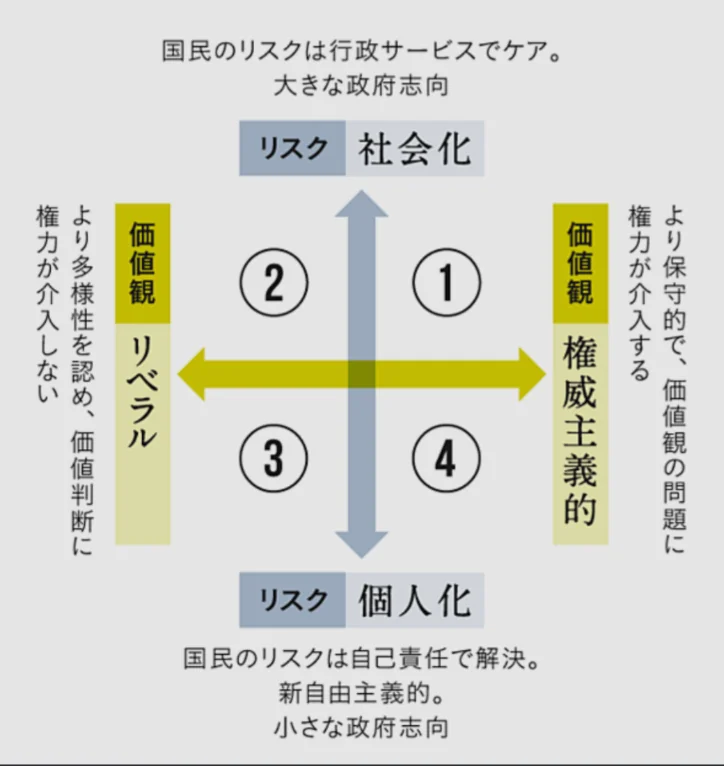

# 政治思想とは何か

- 政治思想とは「社会はどうあるべきか・国家は何をすべきか」についての体系的な考え方です。
- 日常では「右派・左派」「保守・リベラル」という言葉が使われますが、これらの意味は時代・国によって大きく異なり、単純な二項対立では捉えきれません。
- 左右の軸の起源はフランス革命期の議会にあります。国王権力を支持する保守派が議長席の右側に、革命を支持する改革派が左側に座ったことが由来です。
    - 現代では大まかに「**左派**＝平等・再分配・変化を重視」、「**右派**＝自由・伝統・秩序を重視」という傾向がありますが、これだけでは不十分です。
- 政治的立場を理解するには少なくとも二つの軸が必要です。
    - **経済軸**（左右）：「経済的平等と再分配を重視するか」vs「経済的自由と市場を重視するか」
    - **社会軸**（権威主義vs自由主義）：「社会的秩序・伝統・規律を重視するか」vs「個人の自由・多様性・変化を重視するか」
- この二軸で考えると、それだけで4つの派閥が生まれます。
    
    
    
- もちろん、上記以外にも様々な軸があり、多様な政治思想が生まれています。
