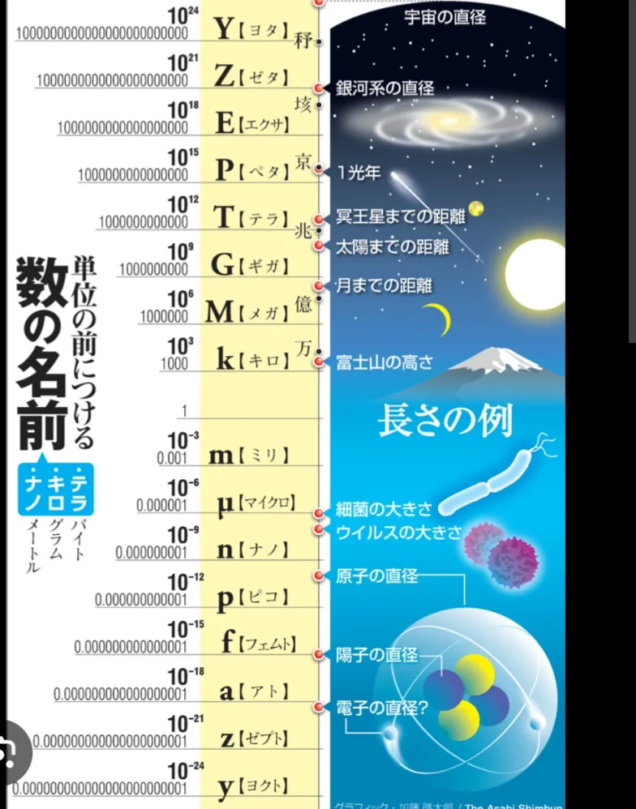

# 指数と累乗

- 数学の世界では、2×2を2²（2の2乗）、2×2×2 を 2³と書きます。この「何乗」という表記を**指数**と呼びますす。一見地味に見えますが、指数は「**爆発的な増加**」を表します。
    - 折り紙を1回折ると2層、2回折ると4層、3回折ると8層……10回折ると1024層、42回折ると月まで届く厚さになると言われています。
- 逆に、**非常に小さな数**を表すときにも指数は使われます。ウイルスの大きさは約0.0000001メートルですが、「10⁻⁷メートル」というように書くとスッキリします。
- 10の何乗かを表す言葉は、日常にも溢れています。**キロ**（10³）・**メガ**（10⁶）・**ギガ**（10⁹）・テラ（10¹²）…などがあります。
    
    
    
