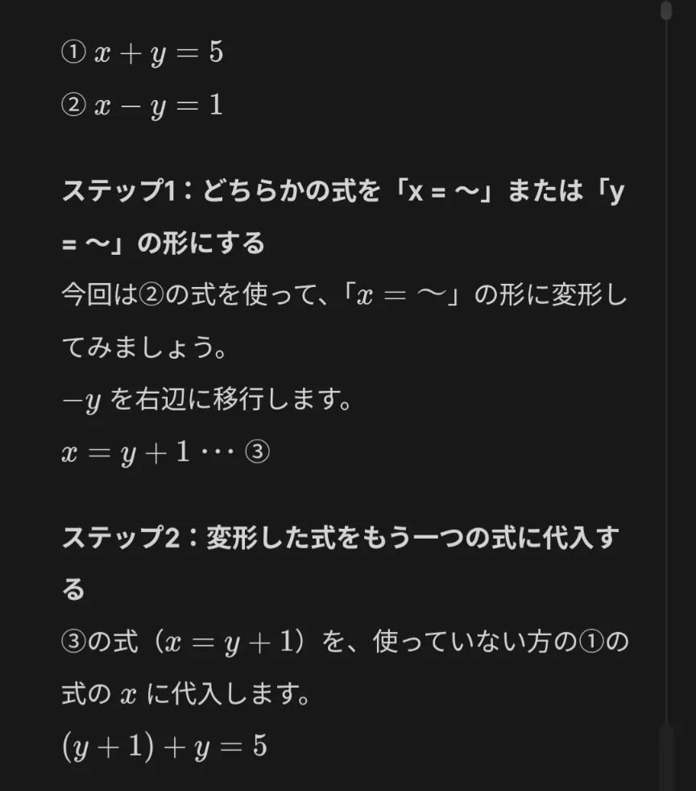
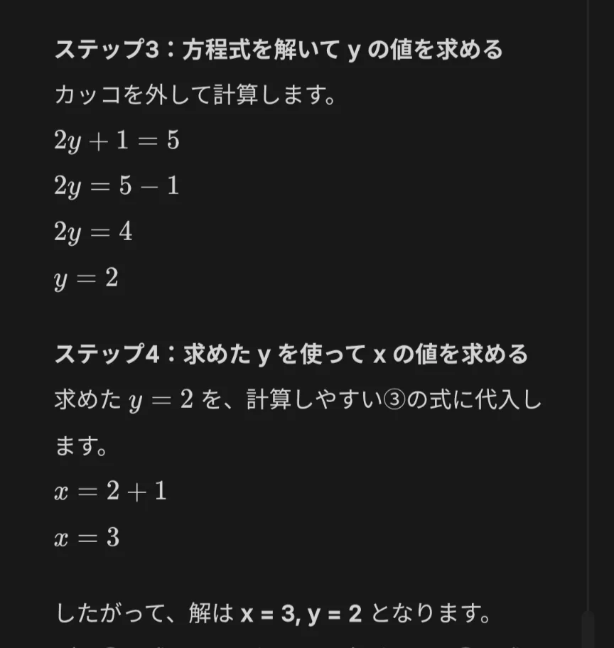

# 連立方程式

- **未知数**（=変数）が 2つ（xとy）あるとき、方程式が1つしかないと、解が**無数に存在**してしまいます。
- 例えば、x＋y＝5という式は、（x＝1、y＝4）でも、（x＝2、y＝3）でも成立します。しかし、ここに「x－y＝1」という二つ目の条件を加えると、x＝3、y＝2という唯一の解が決まります。このように、複数の方程式を組み合わせて解を考えるのが、**連立方程式**の考え方です。
    - 実際に、上の連立方程式を解いてみましょう。
        
        
        
        
        
- 大事なのは「**条件の数と未知数の数が一致すると解が決まる**」ということです。今回は、xとyという2つの未知数があったので、解を1通りにするためには式が2つ必要でした。もし、未知数が3つあるなら、式も3つないと解が定まりません。

- 問題
    
    ①1食あたりの食事を「カロリー 450kcal」「タンパク質 55g」にぴったり合わせたい。なお、使う食材は「鶏むね肉」と「白米」の2つだけである。
    
    鶏むね肉は100gあたり150kcalで、タンパク質 25g。白米は100gあたり150kcalで、タンパク質 5g。さて、目標の栄養素をぴったり摂取するためには、鶏むね肉と白米をそれぞれ何g食べればよいか。
    
- 答え
    - ①
        
        （答）鶏むね肉200g、白米100g。
        
        （解説）鶏むね肉をx（g）、白米をy（g）食べるとする。カロリーについて、1.5x + 1.5y = 450。タンパク質について、0.25x + 0.05y = 55。これを解く。
        
    
