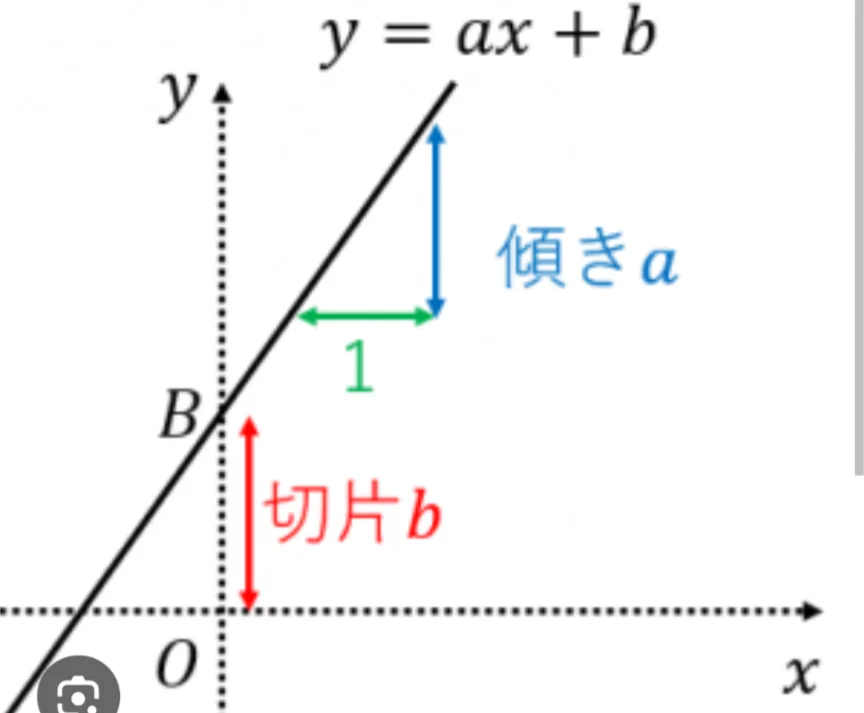

# 一次関数と直線

- **y＝ax＋b**（aとbは定数）という形の関数を**一次関数**と呼びます。グラフにすると**必ず直線**になるのが特徴です。
    
    
    
- aは「**傾き**」（直線の急さ）と呼ばれます。xが1増えたときに、yの値がどれだけ変化するか、を表す値です。
- bが「**y切片**」（x＝0のときのy、つまり直線がy軸と交わる点）を表します。
- aが大きいほど急な直線、aがゼロなら水平な直線、aがマイナスなら右下がりの直線になります。切片bは直線を上下にずらす役割です。

- 一次関数は日常の至るところにあります。例えば、タクシーの料金が「初乗り700円＋1kmあたり100円」なら y＝100x＋700という一次関数で表現できます。携帯の料金プランも、電気料金も、多くが一次関数で近似できます。グラフを見ると「どこで料金が逆転するか」「どちらのプランがお得か」が一目でわかります。

- 問題
    
    ① y = -3x + 12。この式の傾きとy切片はいくつか。
    
    ② ①の式において、xの値が7増えるとき、yの値はどれだけ変化するか。
    
    ③次のうち、（ア）x軸に平行、（イ）y軸に平行、になるものをそれぞれ選べ。
    
    y=x , y=-4 , y=2x, x=12, 3x+4y=0, x=-y
    
    ④ あなたの家のエアコンは古く、夏の電気代に悩まされています。そのまま使い続けると、買い替え費用は かからないが、1か月の電気代が 8,000円かかる。最新の省エネ機種に買い替えると、本体と工事費で最初に120,000円 かかるが、1か月の電気代は 3,000円 に下がる。最新機種に買い替えた場合、「何ヶ月」より長く使い続ければお得になるか。
    
- 答え
    - ①
        
        （答）傾きは-3。y切片は12。
        
    - ②
        
        （答え）-21（21減る）
        
        （解説） グラフの傾きは、xが1増えたときに、yの値がどれだけ増えるか、ということを表している。今回は傾きが-3であるため、xが7増えると、yの値は -3×7= -21変化する。
        
    - ③
        
        （答）（ア）x軸に平行：y=-4　（イ）y軸に平行：x=12
        
        （解説）y=（数）の形はxが変わってもyが一定なので、x軸に平行な直線になる。x=（数）の形は、y軸に平行な直線になる。
        
    - ④
        
        （答）24か月
        
        （解説）使う月数をxとする。古いエアコンの費用は8000x円、新しいエアコンの費用は120000+3000x円。8000x=120000+3000xを解くとx=24。24か月より長く使えば、買い替えた方がお得になる。
    
