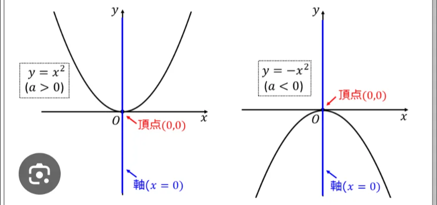

# 二次関数と放物線

- **y＝ax²+bx+c**という形（a,b,cは定数）の関数を**二次関数**と呼びます。xの2乗が出てくる関数のことです。
- グラフにすると、**放物線**と呼ばれるU字型の曲線になります。aが正の値ならグラフは下に凸、負の値なら上に凸になります。
    
    
    

- 放物線は自然界に頻繁に登場します。ボールを投げたときの軌跡、噴水の水の形、懸垂橋のケーブルの形……これらはすべて放物線です。

- 問題
    
    ①次のうち、yがxの2次関数の形で表されるものをすべて選べ。
    
    ア）y=x²/3　イ）x²y=12　ウ）2y+4x²=0
    
    ② ある2次関数について、x=1のときy=6、x=2のときy=11、x=3のときy=18である。yをxの式で表わせ。
     
    
- 答え
    - ①
        
        （答）ア、ウ
        
        （解説）xの2乗に比例、つまり2次関数を選べ、という問題である。アは自明。イとウを、yについて解くと、イはy=12/x²、ウはy=-2x²となるがわイは1/x²に比例するため、不適。
        
    - ②
        
        （答）y=x²+2x+3
        
        （解説）一般に2次関数はy=ax²+bx+cの形で表される。ここに、x=1, y=6を代入すると、6=a+b+c。x=2, y=11を代入すると、11=4a+2b+c。x=3, y=18を代入すると、18=9a+3b+c。これを連立方程式として解くと、a,b,cが分かる。
        
