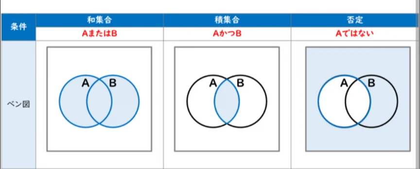

# 集合の考え方

- **集合**とは「ものの集まり」のことです。「1以上10以下の整数の集合」「東京都民の集合」「好きな食べ物がピザである人の集合」……何らかの条件を満たすものをひとまとめにしたものが集合です。
- 集合の関係を視覚化するのが**ベン図**です。「その集合に属するもの」を円によって表します。
    - 集合に属さないものは、円の外側になります（**補集合**）。
    
    
    
- 円を二つ重ねて描いたとき、重なった部分は「両方の集合に属するもの（**積集合**）」、二つの円全体が「どちらかの集合に属するもの（**和集合**）」を表します。
- 「AまたはB」のことを「A∪B」、「AかつB」のことを「A∩B」と表すことがあります。
