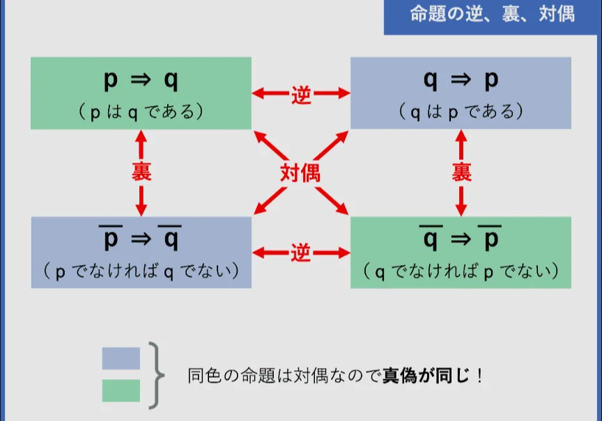

# 逆・裏・対偶

- 「AならばB」という命題から、三つの変形命題が作れます。
    - **逆**：「BならばA」
    - **裏**：「AでなければBでない」
    - **対偶**：「BでなければAでない」です。
    
    
    
- このうち最も重要な関係が対偶です。「AならばB」が真でも、逆と裏は必ずしも真とは限りません。一方、対偶「BでなければAでない」も必ず真になります。
