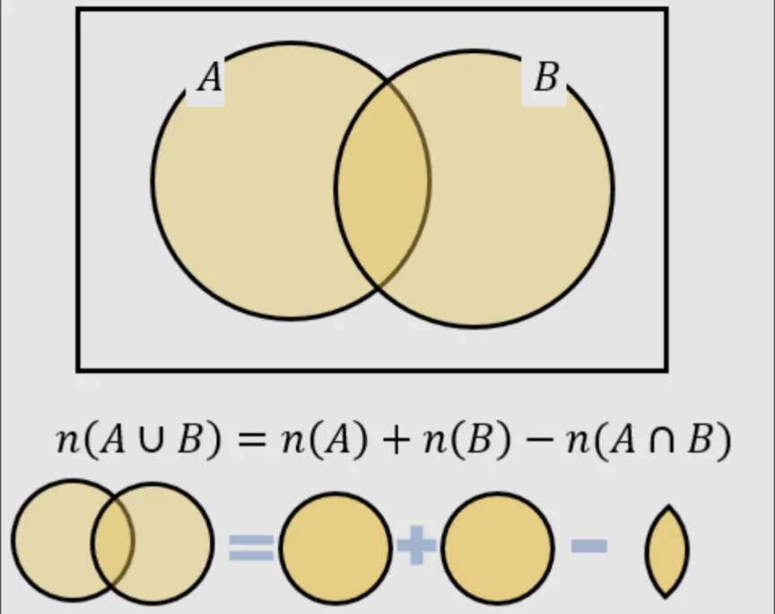

# 練習問題

この章（集合と論理）の練習問題をまとめたものです。

## 必要条件と十分条件（MA04-04）

- 問題
    
    ①クラス41人に対して、通学時に電車、バスを利用するかどうかに関してアンケートを取ったところ、電車を使う人が31人、バスを使う人は16人、両方とも使う人が9人いた。電車もバスも使わない人は何人か。
    
    ②1〜100までの数のうち、3の倍数でも5の倍数でもないものはいくつあるか。
    
    ③「x²=4」なら、「x=2」である。真か偽か。
    
    ④「すべての男性は優しい」という命題が偽であるとき、確実に言えるのは以下の選択肢のうち、どれか。
    
    - 選択肢
        
        1 すべての男性は優しくない
        
        2 すべての女性は優しい
        
        3 ある男性は優しくない
        
        4 優しくなければ男性でない
        
        5 ある女性は優しい
        
    
    ⑤ある小学校の集団に国語、算数、理科、社会の 4 教科について調査したところ、次のア～ウのことがわかった。このとき確実にいえるのはどれか。
    
    - ア〜ウ
        
        ア：算数が得意な生徒は、国語が得意ではない。
        
        イ：理科が得意な生徒は、社会が得意ではない。
        
        ウ：理科が得意でない生徒は、国語が得意である。
        
    - 選択肢
        
        1 国語が得意な生徒は、社会が得意である。
        
        2 算数が得意な生徒は、社会が得意である。
        
        3 理科が得意な生徒は、算数が得意である。
        
        4 社会が得意な生徒は、算数が得意ではない。
        
        5 理科が得意な生徒は、他にも得意な科目がある。
        
    
    ⑥次のA,B,Cの命題から正しく導かれるものはどれか。
    
    - A〜C
        
        A：まじめな人は、女性に人気がある。
        
        B：仕事熱心な人は、まじめである。
        
        C：まじめな人は、上司からの信頼がある。
        
    - 選択肢
        
        1 女性に人気のある人は、上司からの信頼が厚い。
        
        2 仕事熱心でない人は、女性に人気がない。
        
        3 上司から信頼が厚くない人は、仕事熱心でない。
        
        4 女性に人気のない人は、上司からの信頼が厚くない。
        
        5 上司から信頼の厚い人は、仕事熱心である。
        
    
- 答え
    - ①
        
        （答）6人
        
        （解説）電車を利用する人とバスを利用する人の積集合（共通部分）を求めたい。両方使う人が1人もいないとすると、31+16=47となり、全体の41人より大きくなってしまう。そのため、溢れた6人（47-41）は、どちらも利用していると考えられる。
        
        積集合や和集合をもとめる公式が以下の図のようにして定式化されている。これをもとに考えても良い。
        
        
        
    - ②
        
        （答）53個
        
        （解説）以下のようなベン図を考えてみるとわかりやすい。3の倍数でも5の倍数でもないような数（図の青い部分）を求めるには、100から、3の倍数または5の倍数であるような数（図の白い部分）を引けば良い。
        
        白い部分（和集合）は、①の公式を用いて求める。3の倍数は100/3=33.3…より、33個。5の倍数は、100/5=20個。3の倍数かつ5の倍数であるような数、すなわち15の倍数は、100/15=6.…より、6個である。図の白い部分は、33+20-6=47個。答え（青い部分）は、100-47=53個である。
        
        
        
    - ③
        
        （答）偽
        
        （解説）「x²=4」であるなら、必ず「x=2」であるわけではなく、「x=-2」の場合もある。よって、この命題は偽（正しくない）。
        
    - ④
        
        （答）3
        
        （解）「すべての男性が優しい」が正しくないというのは、すなわち、全員が全員優しいわけではない、ということである。つまり、男性の中には、少なくとも1人は優しくない人間がいる。
        
        1について、すべての男性が優しくない可能性はあるが、問題文の情報のみからは判断できない。また、2,5について、女性については言及がないので、同様に判断できない。4について、優しくない男性がいるわけだから、これは正しくない。よって、答えは3。
        
    - ⑤
        
        （答）4
        
        （解説）メモを使って整理しながら、対偶の考え方を用いると良い。
        
        1について、アの対偶を取ると、「国語が得意な人は算数が得意でない」になる。算数の得意不得意と社会の得意不得意が繋がるヒントがないため、これは正しくない。
        
        2について、アと、ウの対偶「国語が得意でない人は理科が得意」とイを繋げると、「算数が得意→国語苦手→理科得意→社会苦手」となり、すなわち、社会は苦手なので正しくない。
        
        3について、イより、社会が苦手なことは分かるが、社会の得意不得意と算数の得意不得意がつながるヒントがないため、これは正しくない。
        
        4について、イの対偶「社会が得意な人は理科が苦手」と、ウ、アの対偶を繋げると、「社会得意→理科苦手→国語得意→算数苦手」となり、すなわち算数は得意でないため、正しい。
        
        5について、イより、社会が苦手なことはわかるが、社会の得意不得意とほかの科目が繋がるヒントがないため、正しくない。
        
    - ⑥
        
        （答）3
        
        （解説）⑤と同様に考える。
        
        1について、女性人気とほかの概念がつながるヒントがないため、正しくない。
        
        2について、ア〜ウのどれを使っても、「仕事熱心でない人は〜」という命題を作れないので、正しくない。
        
        3について、ウの対偶「上司からの信頼が厚くない人は、真面目でない」と、イの対偶「真面目でない人は仕事熱心でない」を合わせると、正しいことが分かる。
        
        4について、アの対偶より、「女性人気のない人は真面目でない」こと、また、イの対偶から、「仕事熱心でないこと」もわかるが、上司からの信頼はわからない。
        
        5について、ア〜ウのどれを使っても、「上司からの信頼が厚い人は〜」という命題を作れないので、正しくない。
