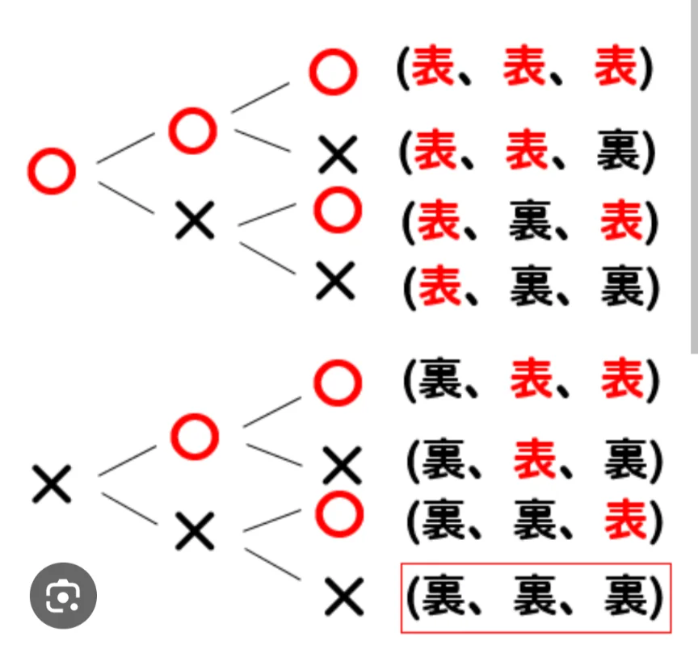

# 場合の数・樹形図

- 「**場合の数**」とは、ある出来事が起こりうるパターンの数です。
- 数え漏れや重複なく数え上げるることが意外と難しいので、**樹形図**を使って求めることがあります。
    - 例えばコインを2回投げるとき、1回目が表か裏、2回目が表か裏……と枝分かれさせて図を書くと、表表・表裏・裏表・裏裏の4通りが視覚的に見えます。この木の枝のような図が樹形図です。
    
    
    

- 場合の数の基本ルールとして、「積の法則」があります。**積の法則**は「AとBが独立して起きるとき、全体の場合の数はA×B」というものです。「**独立**」というのは、一方が、もう一方とは全く無関係の確率で起きることを言います。
    - コインを2回投げるなら、出る表裏の組み合わせは全部で、2×2＝4通り、サイコロを2回振るなら、出る目は6×6＝36通りです。
        - コインやサイコロを投げる一回一回の試行は独立（お互いに無関係）です。
