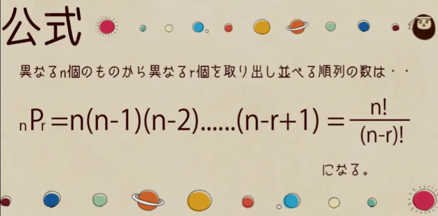
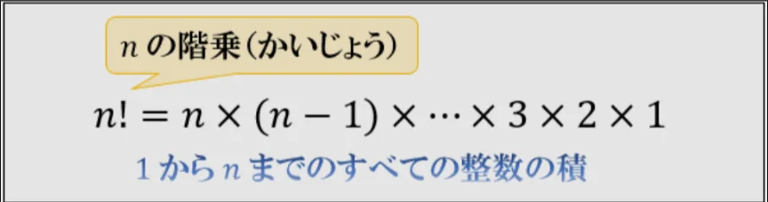
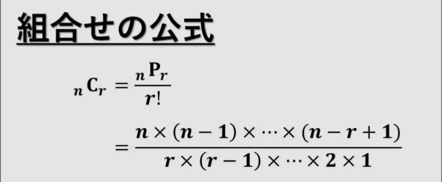

# 順列と組み合わせ

- **順列**とは、異なるいくつかのものから「いくつか（または全部）を取り出して、順番をつけて1列に並べる」ことです。
    - 例えば、A・B・Cの3人から2人を選んで一列に並べることを考えます。この場合、1人目はABCの三択で、2人目は、1人目に選ばれた人を除いた二択なので、場合の数は3×2で6通りです。
    - 実際に数えてみると、AB,  AC, BA, BC, CA, CBの6通りあることがわかります。
- 一般に「n個から r個を選んで並べる順列」は、**nPr**と書き、**n×(n-1)×…×(n-r+1)** という形で計算することで、自動的に場合の数が求まります。
    - 上の例は、₃P₂ と表すことができ、 ₃P₂ = 3×2 = 6 です。
    - 「n個すべてを並べる順列」は、**n！**と書き、nの**階乗**と呼びます。nPr の r に n を代入したものと同じ値になります。
    
    
    
    
    
- **組み合わせ**は、**順番の区別がない**場合の数のことです。A・B・Cの3人から2人を選ぶだけなら、「ABという選び方」と「BAという選び方」は同じグループなので一つとして数えます。
    - この場合の組み合わせは3通り（AB, BC, AC）です。
- 一般に「n個からr個を選ぶ組み合わせ」は、**nCr**と書き、nPr を r! で割って計算します。
    
    
    
