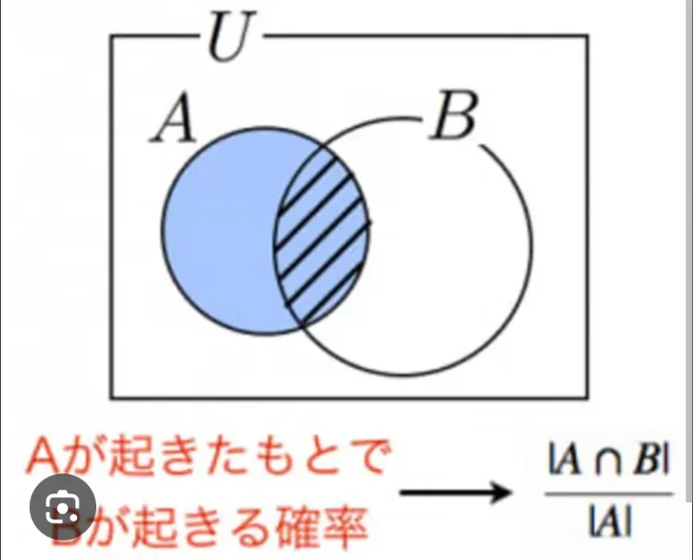

# 条件付き確率

- **条件付き確率**とは「ある条件が与えられたもとでの確率」です。例えば、「サイコロを振って6が出る確率」と「サイコロを振って偶数の目が出たことが分かっているとき、それが6である確率」は違います。**条件が加わることで確率は変わります**。
- 「事象Aが起きたという条件のもとで事象Bが起きる確率」をP(B|A)と書き、次の式で定義されます。
    - P(B|A)＝P(AかつB)÷P(A)
    - つまり「AとBが両方起きる確率」を「Aが起きる確率」で割ったものです。
    
    
    

- 具体例を出します。52枚のトランプから1枚引いたら、引いたカードが「ハートである」ことがわかりました。このとき、それが「絵札（J・Q・K）である」確率はいくらでしょうか。
    - P(AかつB)＝3/52（ハートの絵札は3枚）、P(A)＝13/52（ハートは13枚）なので、P(B|A)＝(3/52)÷(13/52)＝3/13です。
    - 「ハートに限定した13枚の中に絵札が3枚」と考えると直感的にも納得できます。
