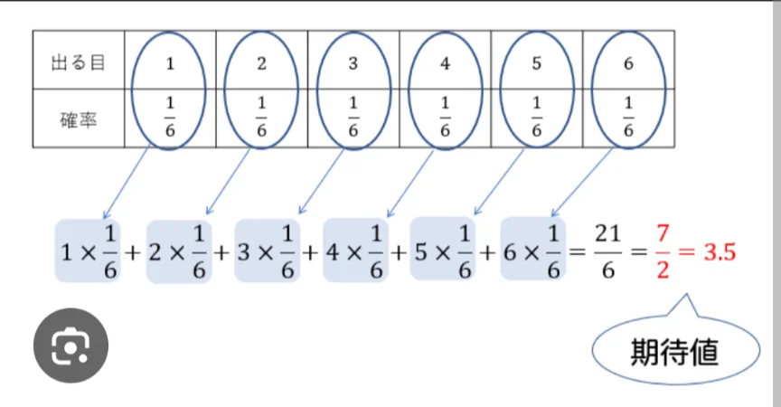

# 期待値

- **期待値**とは「**起こり得る結果の平均値**」のことです。
    - 起こり得る結果と、それが起こる確率を掛け合わせ、全パターン足し合わせることで求めることができます（下記参照）。
- 例えば、サイコロを1回振ったときに出る目の期待値について考えてみましょう。下図のように計算します。答えは、3.5です。
    - 3.5という目が直接出るわけではありませんが、何回も振り続けると、その平均は3.5に近づいていきます。
    
    
    

- 期待値の考え方はギャンブルの分析などでも有効です。宝くじやカジノが損であることも、期待値の考え方を使うことで証明できます。
    - 保険も、期待値的には「損」です。しかし、保険の価値は期待値ではなく「最悪の事態を避ける」安心感にあります。期待値だけで判断すべき場面とそうでない場面を区別することが、賢い意思決定につながります。
