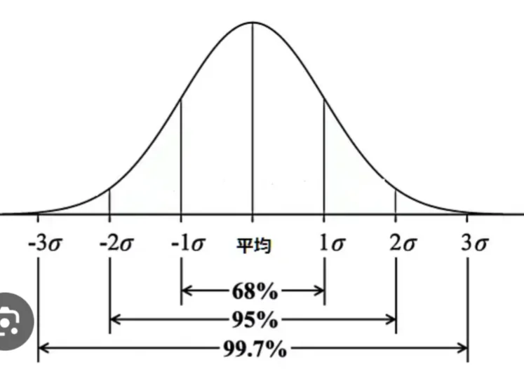

# 正規分布

- 世の中の多くのデータは、下図のように、真ん中の層が厚く、外側に向かって数が減るような分布を取ります。これを**正規分布**といいます。
    - 人の身長・テストの点数・製品の誤差・気温の分布……これらはすべてほぼ正規分布に従います。
    
    
    

- 問題
    
    ①5種類のケーキと3種類のジュースのそれぞれから1種類ずつ選ぶ場合、選び方は何通りあるか。
    
    ②かけっこで3人(A, B, C)が競争するとき、1位・2位・3位の順位のつき方は何通りあるか。
    
    ③5人（A, B, C, D, E）の中から、リーダーと副リーダーを決めたい。選び方は何通りあるか。
    
    ④5人（A, B, C, D, E）の中から、委員会の当番を2人を決めたい。選び方は何通りあるか。
    
    ⑤サイコロを2回投げる。出た目の合計が5になる場合の数はいくつか。また、確率はいくつか。
    
    ⑥2人でじゃんけんをする。あいこになる確率はいくつか。
    
    ⑦コインを2回投げる。2回とも表が出る確率はいくつか。また、2回とも表だったとき、3回目も表が出る確率はいくつか。
    
    ⑧10本のくじのなかに当たりが2本ある。1本引いたら、引いたくじは戻さずにもう一度引く。（1）2回連続で当たる確率はいくつか。（2）2回とも外れる確率はいくつか。（3）2回のうち、少なくとも1回が当たる確率はいくつか。
    
    ⑨3つの箱がある。そのうちの1つには宝物が入っているが、それ以外はゴミが入っている。あなたが、3つの中から1つを選んで開けようとすると、答えを知っている友人が、残り2つの箱の中から、不正解の箱を1つ選んで開けてみせた。このとき、はじめに選んだ箱をそのまま開けたときに、宝物が入っている確率はいくつか。また、開ける箱をもう1つ残っている方に変えたとき、宝物が入っている確率はいくつか。
    
    ➉ある病気の検査では、実際に病気にかかっている人が「陽性」と判定される確率が99%である。また、病気でない人が誤って「陽性」と出る確率は1%である。自分が検査を受けて「陽性」と出たとき、実際に病気にかかっている確率はいくつか。なお、病気にかかっている人は全体の1%しかいないものとする。
    
    ⑪サイコロを1回振って、出た目の数だけ100円もらえるゲームがある。もらえる金額の期待値はいくつか。
    
    ⑫1枚300円の宝くじがある。当たる確率は5%で、当たると3000円もらえる。このくじの期待値を求め、得か損か判断せよ。
    
- 答え
    - ①
        
        （答）15通り
        
        （解説）積の法則が使える。5種類のケーキそれぞれに対して、ジュースの選び方が3通りずつあるので、5×3=15．
        
    - ②
        
        （答）6通り
        
        （解説）1位になるのは、A,B,Cの3通り。2位になるのは、1位以外の2人のどちらかなので2通り。3位は残った1人で1通り。積の法則より、3×2×1=6通り。一般に、n個のものの並べ方の総数は、n！= 1×2×…×nで表され、この左辺をnの**階乗**と呼ぶ。
        
    - ③
        
        （答）20通り
        
        （解説）5人から2人を選ぶが、この2人は区別する必要がある。よって、順列の考え方を用いる。₅P₂=5×4=20通り。
        
    - ④
        
        （答）10通り
        
        （解説）この問題では選ぶ2人を区別する必要がない。よって、組み合わせの考え方を用いる。₅C₂=5×4/2=10通り。
        
    - ⑤
        
        （答）4通り。1/9。
        
        （解説）合計が5になる場合をすべて列挙する。（1,4）（2,3）（3,2）（4,1）の4通りである。サイコロを2回振った場合の出る目の組み合わせは6×6=36通りなので、出た目の合計が5になる確率は、4/36=1/9である。
        
        サイコロを2回投げる。出た目の合計が8以上になる場合の数はいくつか。また、確率はいくつか。
        
    - ⑥
        
        （答）1/3
        
        （解説）片方の人が出せる手が3通りあり、そのそれぞれに対して、もう片方の人の出せる手が3通りあるので、手の組み合わせは全部で、3×3=9通りある。あいこになるのは、2人ともグー、2人ともチョキ、2人ともパーの3通りなので、確率は3/9=1/3。
        
    - ⑦
        
        （答）1/4。1/2。
        
        （解説）表が出る確率は1/2。これが2回続くなら、1/2 × 1/2 =1/4。3回目に表が出るかどうかは、それまでに表が出たかどうかには全く関係がない（独立）。よって、1/2。
        
    - ⑧
        
        （答）（1）1/30（2）49/90（3）41/90
        
        （解説）
        
        - （1）
            
            1本目で当たる確率は、3/10である。1本当たりを引くと、残りのくじは全部で9本、当たりはそのうち1本になるので、2回目に当たる確率は1/9となる。つまり、3/10 × 1/9=1/30。
            
        - （2）
            
            1本目で外れる確率は、7/10。1本外れを引くと、残りは全部で9本、当たりはそのうち2本なので、そこでも外れる確率は7/9。つまり、7/10 × 7/9=49/90。
            
        - （3）
            
            少なくとも1回は当たる、ということは、1本目でのみ当たるパターン、2本目でのみ当たるパターン、両方とも当たるパターンの全てを考えて足さなければならない。これは面倒なので、1本も当たらない確率（**余事象**と呼ぶ）を1（=100%）から引くことによって答えを求める。1本とも当たらない確率は（2）より、49/90である。つまり、答えは1 - 49/90 = 41/90。
            
        
    - ⑨
        
        （答）1/3。2/3。
        
        （解説）はじめに選んだ箱に宝物が入っている確率は単純に1/3である。悩ましいのは、もう1つを選んだ場合の確率である。ある条件があった場合の確率は**条件付き確率**の考え方を用いる。自分が選ばなかった2つの箱のうち、友人が選んだ箱が不正解である確率は1/2である。また、友人が選んだ箱が不正解で、かつ、もう1つの箱が正解である確率は1/3である。条件付き確率の公式を使えば、この確率は1/3 ÷ 1/2 =2/3である。つまり、開ける箱を変えたほうが、当たる確率が高い。
        
    - ➉
        
        （答）1/2
        
        （解説）条件付き確率を用いる。まず、陽性になる確率を求める。病気になっていて陽性になるパターンと、病気になっていないのに陽性になるパターンがある。そもそも病気になる人が1%しかいないため、前者は1% × 99% = 0.01×0.99=0.099。後者は、0.99×0.01=0.099。合わせて、0.198。このうち、実際に病気になっていて陽性なのは、0.099である。よって、条件付き確率は、0.099/0.198=0.5。
        
        ある病気の検査では、実際に病気にかかっている人が「陽性」と判定される確率が99%です。また、病気でない人が誤って「陽性」と出る確率は1%です。自分が検査を受けて「陽性」と出たとき、実際に病気にかかっている確率はいくつか。なお、病気にかかっている人は全体の1%しかいないものとする。
        
    - ⑪
        
        （答）350円
        
        （解説）1/6の確率で1が出たら100円、2が出たら200円…となる。期待値は確率×結果で求められるので、1/6×100 + 1/6×200 +…と計算していけばよい。2100/6=350円。つまり、1回サイコロを振るごとに、平均350円のリターンが期待できることになる。
        
        サイコロを1回振って、出た目の数だけ100円もらえるゲームがある。もらえる金額の期待値はいくつか。
        
    - ⑫
        
        （答）損
        
        （解説）期待値は、0.05×3000=150円である。1枚買っても、平均150円しかリターンがない宝くじを、300円払って買うのは損である。
        
    
