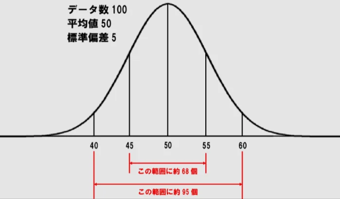

# 分散と標準偏差

- 平均が同じでも、データの「ばらつき」が違うことがあります。先ほどの例のように、「全員の年収が1000万円」と「ほとんどが300万円で、1人だけ1億円」では、平均だけ見ると同じですが、全く違う状況です。このばらつきを数値化したのが**標準偏差**（σ）と**分散**です。
- これらは「**各データが平均からどれだけ離れているか**」の平均です。標準偏差が小さいほどデータが平均に集まっており、大きいほど散らばっていることを意味します。
    - 分散と標準偏差では、厳密には算出方法が異なりますが、概ね意味するところは同じです。本章では、より重要な標準偏差について概説します。
- 正規分布においては、平均から標準偏差プラスマイナス1つ分までの範囲に、全体の68%が収まり、標準偏差2つ分の範囲に95%が収まることが知られています。
    
    
    

- 投資の世界では標準偏差が「リスク」の指標として使われます。平均リターン5%でも、標準偏差が1%の投資と20%の投資では全く性格が違います。
    - 前者は安定的に5%前後で推移しますが、後者は25%の利益が出ることも-15%の損失が出ることもあります。
