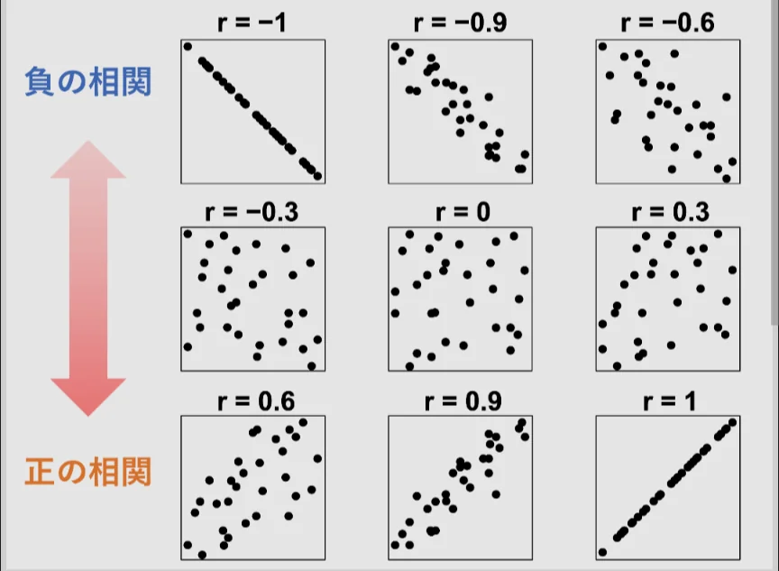
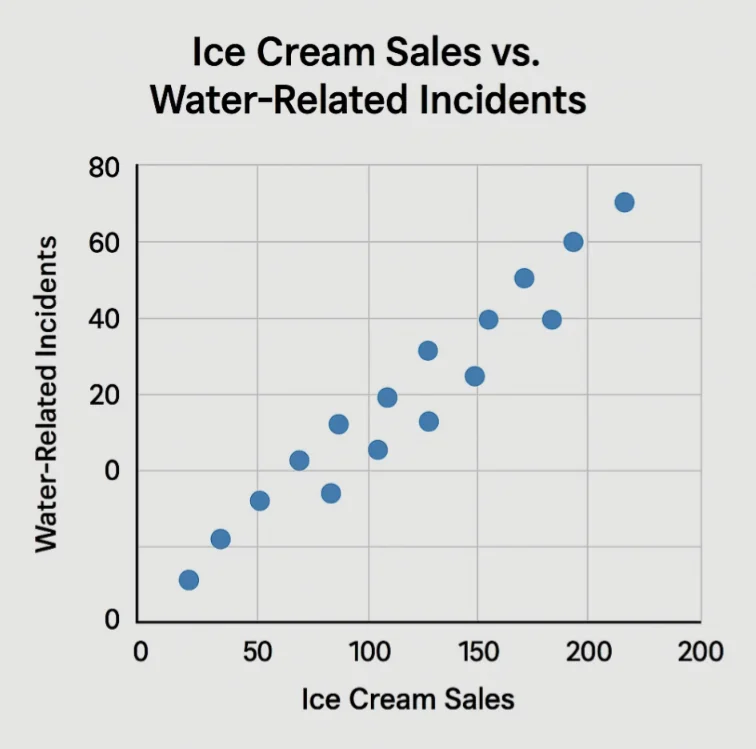

# 相関と因果

- 二つのデータの間に「一方が増えると他方も増える」という関係があるとき、「**相関**がある」といいます。
- 相関の強さは、-1から1の値を取る「**相関係数**」で表され、1に近いほど、強い**正の相関**があり（一方が増えると他方も増える）、-1に近いほど、強い**負の相関**があります（一方が増えると他方が減る）。0に近いほど、無相関です。
    
    
    
- **相関があっても因果関係があるとは限りません**。有名な例を挙げます。「アイスクリームの売上と水難事故の件数には、強い正の相関がある」というデータがあります。では「アイスを食べると溺れやすくなる」と言えるでしょうか。
    - 両者に共通する原因は「気温が高い（夏である）」ことです。気温が高いからアイスを食べたくなる、気温が高いから海に行く人が多くなり、結果、水難事故が増えている、というだけです。このような第三の変数による見かけの相関を「**疑似相関**」といいます。
    
    
    
- 「○○をすると年収が上がる」「△△を食べる地域はがんが少ない」……世の中に溢れる統計的主張の多くは相関であって因果ではありません。
    - ニュースや広告の統計を見るとき、「これは相関？因果？」と問い返すだけで、騙されにくくなります。
