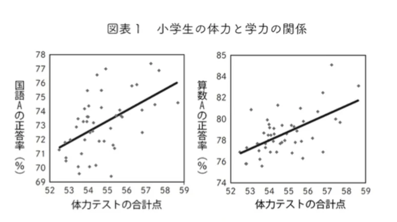
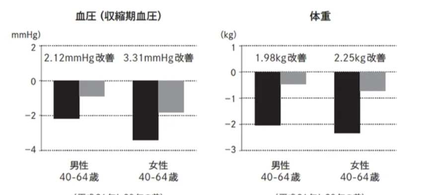

# 練習問題

この章（統計の基礎）の練習問題をまとめたものです。

## 有意差と統計的検定（MA06-04）

- 問題
    
    ① 「8, 6, 9, 11, 6」このデータにおける平均値を求めよ。
    
    ②ある5人の年収が「3000万、350万、300万、450万、400万」のとき、平均値と中央値を求めよ。
    
    ③行きは時速40km、帰りは時速60kmである距離を往復した。速さの平均は時速何kmか。
    
    ④「偏差値」は平均を50として、標準偏差が10になるように、テストの得点を調整して算出した値である。一方、「IQ」は平均を100として、標準偏差が15になるように、IQテストの得点を調整して算出した値である。偏差値60と IQ110、より上位なのはどちらか。
    
    ⑤以下は、小学生の学力と体力との関係を調べたグラフ（**散布図**）である。ここから読み取れるものとして、正しいものを全て選べ。
    
    （1）体力テストの合計が高い人ほど、算数の点数が高い、という相関関係がある。
    
    （2）学力テストの得点を上げる努力をすれば、体力テストの点数も自然と上がる。
    
    （3）体力をつければ、頭が良くなる。
    
    （4）国語よりも、算数のほうが、体力テストとの相関が強い。
    
    
    
    ⑥以下は、健康診断の生活指導（任意参加）を受けた人と受けていない人の、昨年度との健康診断の結果（血圧と体重）の差を比較したものである。生活指導を受けた人が濃い色の棒グラフ、受けていない人は薄い色の棒グラフで表されている。ここから読み取れることとして、正しいものをすべて選べ。
    
    （1）生活指導を受けた人たちは、そうでない人に比べて体重が軽くなった。
    
    （2）女性よりも男性の方が、生活指導の効果が大きいと言える。
    
    （3）生活指導を受けることで、健康になることができる。
    
    （4）生活指導を受けていない人は血圧が前よりも上がっている。
    
    
    
- 答え
    - ①
        
        （答）8
        
        （解説）（8+6+9+11+6）/5 = 8である。ちなみに、例えばざっくり7くらいを基準にして、（+1, -1, +2, +4, -1）/ 5= +1なので、平均は7+1=8点である、というように「仮の平均」を用いることで簡単に計算できる。
        
    - ②
        
        （答）900万。400万。
        
        （解説）平均は、（3000+350+300+450+400）/5 =900万である。中央値は、400万である。実際、日本人の年収も、平均は480万円ほどだが、中央値は400万ほどと、差があることが知られている。
        
    - ③
        
        （答）48km
        
        （解説）行きと帰りの速さの比は40:60=2:3である。行きも帰りも距離は同じなので、かかった時間は速さの比の逆で3:2になるはずである。つまり、時速40kmのスピードだった時間が3、時速60kmで進んだ時間が2あるので、平均は（40×3+60×2）/5 = 48である。
        
    - ④
        
        （答）偏差値60
        
        （解説）偏差値60は、平均よりも標準偏差1つ分高い。これと同等のIQは115（平均100+標準偏差15）である。よって、IQ110よりも、偏差値60のほうが上位である。
        
    - ⑤
        
        （答）（1）（4）
        
        （解説）グラフより、（1）（4）は正しい。（2）（3）はどちらも因果関係の主張をしており、誤り。これらの可能性を否定することはできないが、この散布図からは主張できない。
        
    - ⑥
        
        （答）（1）
        
        （解説）グラフの見方としては、0を基準にして下に伸びた棒グラフになっていれば、前年より改善したと見ることができる。生活指導を受けた人のほうが、より下に伸びたグラフになっているので、（1）は正しい。一方、（2）は逆である。また、すべてのグラフが下向きなので、（4）も正しくない。（3）は、因果関係を主張しており、誤りである。生活指導を受けた「から」健康になったわけではなく、生活指導を積極的に受けるような人たちだから、健康になっただけの可能性がある。
