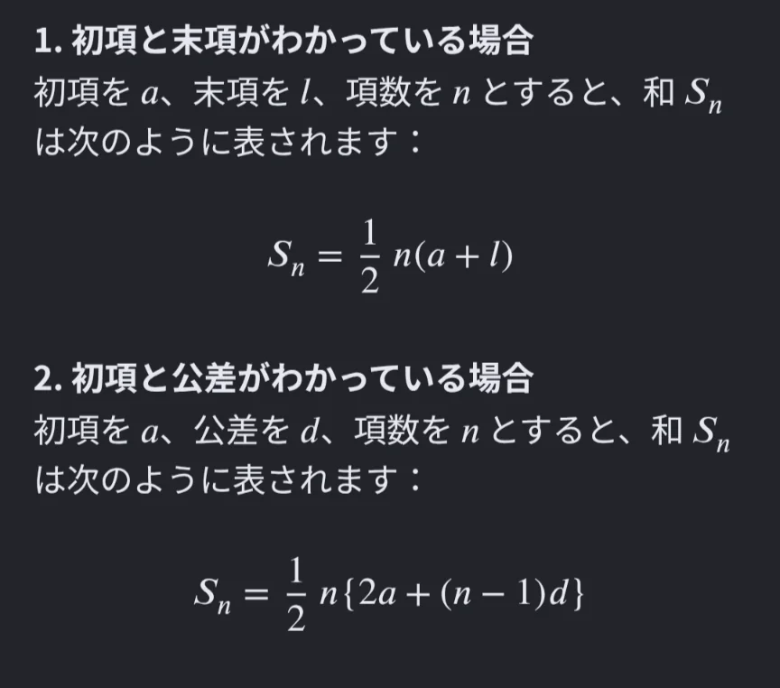

# 等差数列

- 1・3・5・7・9……のように、一定の差で増えていく数の並びを**等差数列**といいます。「等しい差（公差）」が続く数列です。
    - 上のような奇数は、自然数nを用いて、一般に、2n-1 と表すことができます。これを**一般項**と呼びます。nに、数字を1から入れていくことで、奇数をはじめから順番に作ることができます。
- 等差数列の便利な性質が「和を簡単に計算できる」ことです。1から100までの整数の和はいくつか、という問題を考えてみましょう。1＋2＋3＋……＋100を順番に足していくのは大変ですが、こう考えます。1と100、2と99、3と98……どの対も合計が101になります。そういう対が50組あるので101×50＝5050です。
    - この考え方を発見したのは数学者の**ガウス**で、小学生のころに先生から「1から100まで足しなさい」という問題を出されて即答したという逸話が残っています。「どうせ時間がかかるだろう」と高をくくった先生が驚いたというエピソードです。
- 上の考え方を公式化したものが以下です。わかっている情報によって、2つの式を使い分けます。
    - **初項**は、1つ目の数字のこと、末項は最後の数字のことです。
    
    
    
