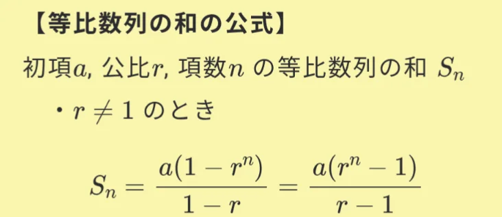

# 等比数列

- 2・4・8・16・32……のように、一定の比（=**公比。**この場合は2倍）で増えていく数の並びを**等比数列**といいます。
    - この数列の一般項は、2n²です。一般に、初項 × nの公比乗で表されます。
- 等比数列にも和の公式があります。
    
    
    
    - 例えば、初項1・公比2の数列（1・2・4・8・16……）の最初の10項の和は、1 × (2¹⁰－1) ÷ (2－1) ＝ 1023です。
- 最も身近な応用が**複利計算**です。元本100万円を年利5%の複利で運用すると、1年後は105万円、2年後は110.25万円……10年後は約163万円、20年後は約265万円になります。単利（毎年5万円ずつ増える等差数列）と比べると20年後の差は歴然です。
    - 「**複利は人類最大の発明**」とアインシュタインが言ったとされる（実際に言ったかは不明ですが）のも、この等比数列的な成長の力を指しています。
