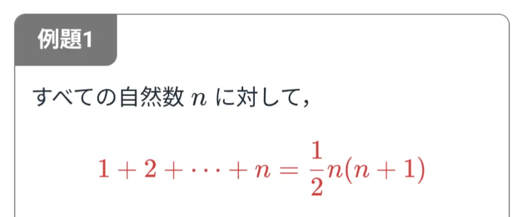

# 数学的帰納法

- 上の式が成り立つことを証明せよ、という問題があったとします。この問題では、「すべての自然数nに対して命題が成り立つ」ということを証明しなければなりません。しかし、無限にある自然数すべてについて一つずつ確認することは不可能です。
- このようなときに使われるのが**数学的帰納法**です。数学的帰納法では、以下の2つを証明します。
    1. **n＝1のとき成り立つ**。
    2. **n＝kのとき成り立つと仮定**すると、**n＝k＋1のときも成り立つ。**
- この2つが示せれば、①よりn＝1で成り立つことから、②よりn＝2でも成り立つ、n＝3でも……と無限に続くことが証明できます。
    - ドミノ倒しのイメージです。最初の1枚が倒れること（①）と、あるドミノが倒れれば次も倒れること（②）が確認できれば、すべてのドミノが倒れると言えます。
