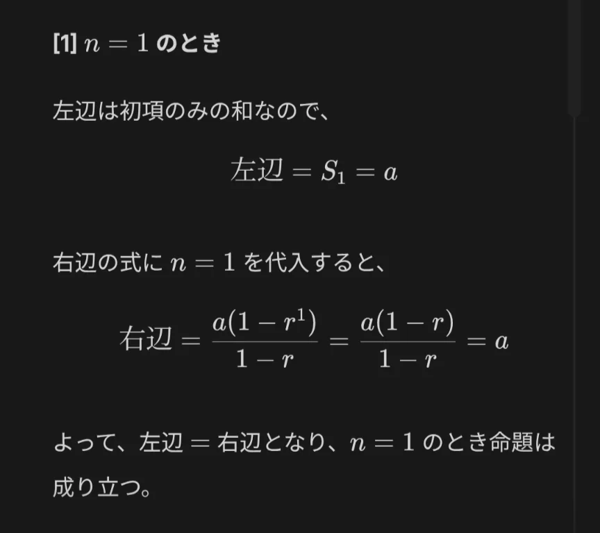
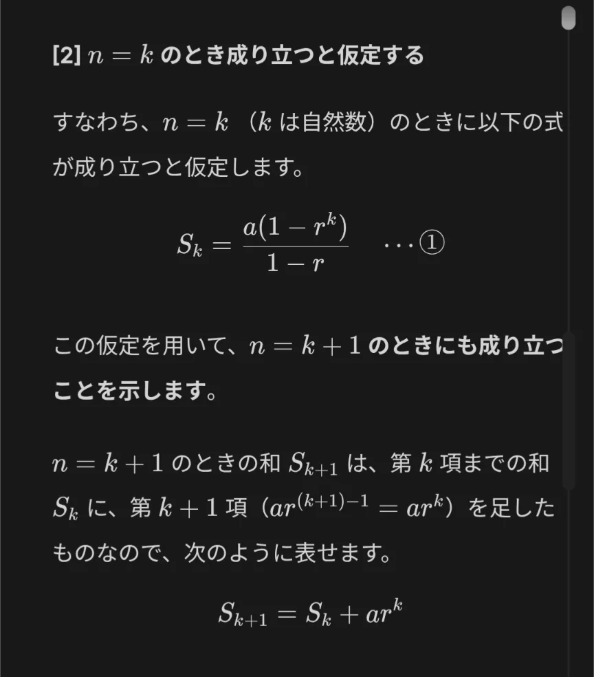
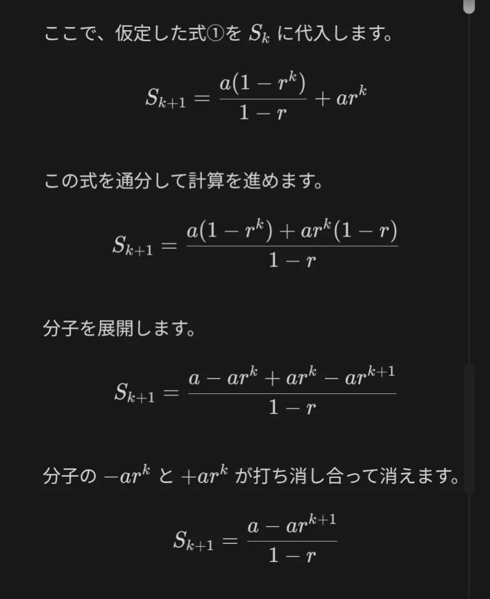
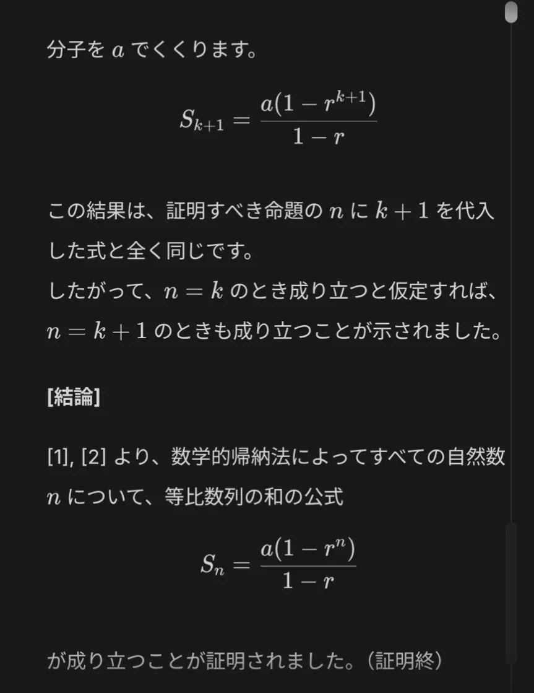

# フィボナッチ数列

- 1・1・2・3・5・8・13・21・34・55……前の二つの数を足すと次の数になる、というルールで作られる数列が**フィボナッチ数列**です。
    - この数列が面白いのは、自然界のあちこちに現れることです。ひまわりの種の螺旋の数、松ぼっくりのうろこの配列、花びらの枚数……これらはほぼ必ずフィボナッチ数になっています。
- さらにフィボナッチ数列の隣り合う数の比（例えば、55÷34≒1.618）は、数が大きくなるにつれて「**黄金比**」に収束することが知られています。
- 問題
    
    ① 1から10までの整数の和を、等差数列の公式を用いて求めよ。
    
    ② 50から100までの整数の和を、等差数列の公式を用いて求めよ。
    
    ③ 3, 12, 48, 192,…という数列の5項目までの和を求めよ。
    
    ④等比数列の和の公式が成り立つことを、数学的帰納法によって証明せよ。
    
- 解答
    - ①
        
        （答）55
        
        （解説） 1つ目の公式を用いると、初項1, 末項10, 項数10なので、10 × 11/ 2 = 55
        
    - ②
        
        （答）3725
        
        （解説）1つ目の公式を用いると、項数50, 初項50, 末項99なので、50 ×（50+99）/ 2 = 3725
        
    - ③
        
        （答）1023
        
        （解説）公比は4, 初項3, 項数5なので、3×（4⁵-1）/ 3 = 1023。4⁵ = 2の10乗=1024に気付けると早い。
        
    - ④
        
        （証明）
        
        
        
        
        
        
        
        
        
