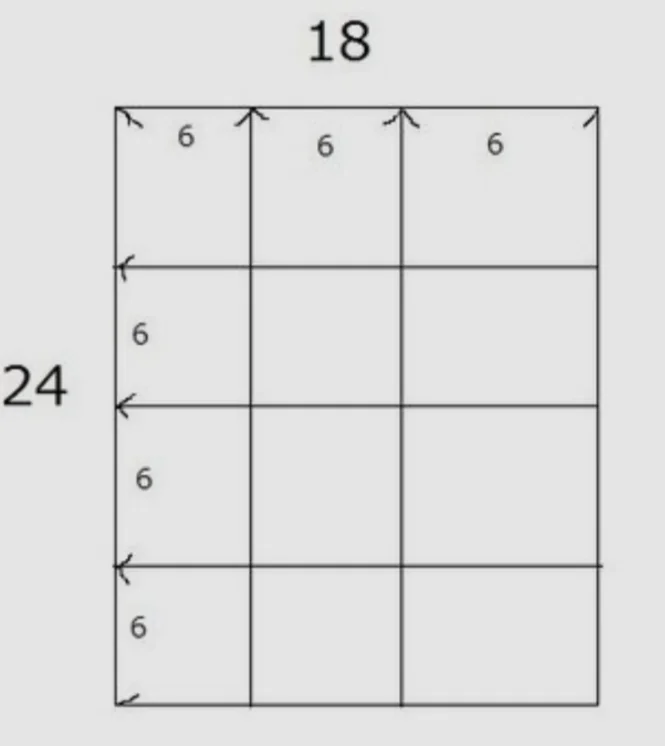

# 最大公約数と最小公倍数

- 二つの整数に共通する約数のうち.最大のものを**最大公約数**、共通する倍数のうち最小のものを**最小公倍数**といいます。
- **最大公約数**の日常的な応用は、「等分する」場面です。縦24cm・横18cmの長方形を、できるだけ大きな正方形のタイルで隙間なく敷き詰めたいとき、タイルの一辺は、24と18の最大公約数＝6cmになります。
    
    
    
- **最小公倍数**は「周期が重なる」場面で使います。2日ごとに来るバスと3日ごとに来るバスが同時に来るのは6日後（2と3の最小公倍数）です。
