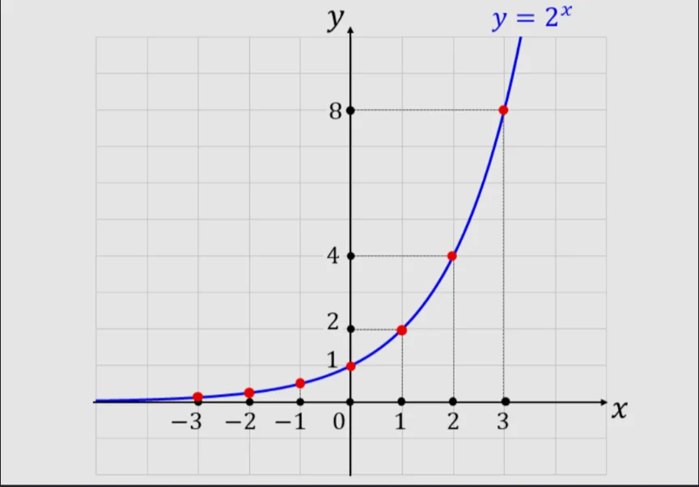

# 指数の拡張

- 2³＝8、2⁴＝16……という整数の指数はわかりやすいですが、指数は自然数だけに限りません。
- まず、マイナスの指数です。2⁻¹はいくつでしょうか。指数を1減らすと値が半分になる、ということから考えると、2³＝8、2²＝4、2¹＝2、2⁰＝1、2⁻¹＝1/2 という流れが見えます。つまり、2⁻ⁿ＝1/2ⁿです。
    - マイナスの指数は「**割り算**」を表しています。
- 次に分数の指数です。2の(1/2)乗はいくつでしょうか。この数字をさらに 2乗すると 2に戻ることがヒントです。2の(1/2)乗 × 2の(1/2)乗 ＝2¹＝2です。２乗して2になる数というのは、√2（2の平方根）の定義そのものです。つまり1/2乗は**平方根**に対応します。
- この拡張によって、指数はあらゆる実数に対して定義できるようになります。2の0.7乗 や 2のπ乗 のようなものに対しても値を計算できるます。グラフにすると滑らかな曲線になり、これが**指数関数**です。
    
    
    
