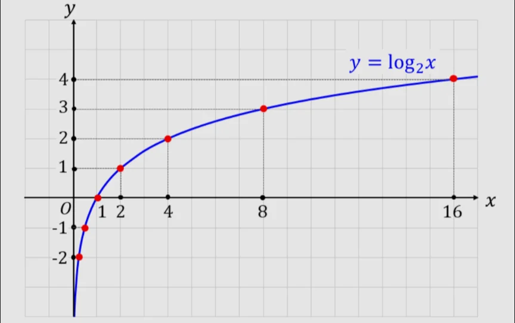

# 対数の意味

- 「2を何乗すると8になるか？」答えは、3です。この「何乗するか」を表すのが、**対数**です。
- 「2を3乗したら8になる」ということを、log₂8＝3と書き、「ログ2の8イコール3」と読みます。ここでの「2」のことを、**底**（てい）と呼びます。
    - 対数は指数の逆です。指数が「何乗した結果か」を表すなら、対数は「何乗すればよいか」を表します。
    
    
    

- 対数が特に便利なのは「掛け算を足し算に変換できる」という性質です。log(A×B)＝logA＋logBという法則があります。
    - これはかつて計算機がなかった時代に天文学者や航海士が複雑な掛け算を対数表を使って足し算に変換することで計算を楽にするために使われました。
- また、よく使われるのが、底が10の**常用対数**と、底がeという特別な数の**自然対数**です。
    - eは約2.718という値を取るネイピア数と呼ばれる無理数で、自然界の成長・減衰現象と深く結びついた数です。
- 問題
    
    ①log₃9=？
    
    ②log₂16=？
    
    ③log₅30は3より小さい。真か偽か。
    
    ④log₅125、log₃81、log₁₀81のうち、最も大きいものはどれか。
    
- 解答
    - ①
        
        （答）2
        
        （解説）3を何乗したら9になるかを考えるとよい。
        
    - ②
        
        （答）4
        
    - ③
        
        （答）真
        
        （解説）log₅25=2、log₅125=3であることを踏まえると、log₅30の直接の値が分からなくとも、2より大きく、3より小さい値であることがわかる。
        
    - ④
        
        （答）log₃81
        
        （解説）log₅125=3である。log₃81=4である。log₁₀81は、直接の値は分からないものの、log₃81よりは自明に小さい。
        
