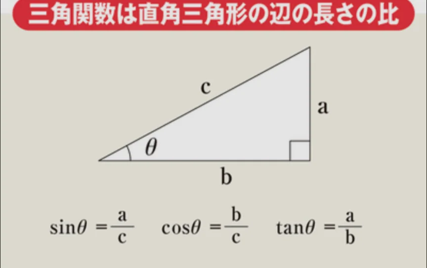

# 三角形と三角関数

- **三角関数**は、直角三角形の辺の長さの比のことです。ある角度をθ（シータ）としたとき、三角関数は以下のように表せます。sinはサイン、cos（コサイン）、tan（タンジェント）と読みます。
    
    
    
- どんな大きさの三角形であっても、角度θが変わらないならば、三角関数の値も変わりません。
    - 各θに対応した三角関数の値は表にまとめられており、必要なときには、それを見て計算に使うことがあります。
