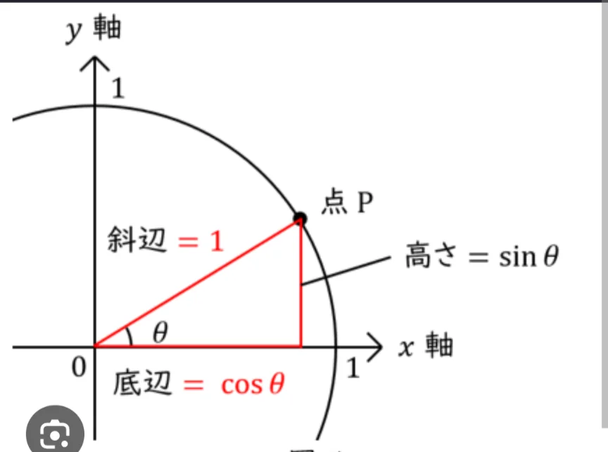
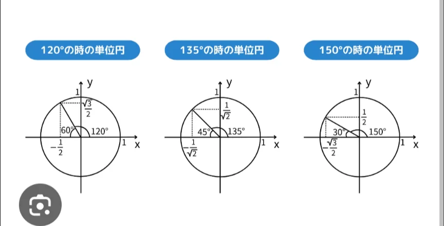
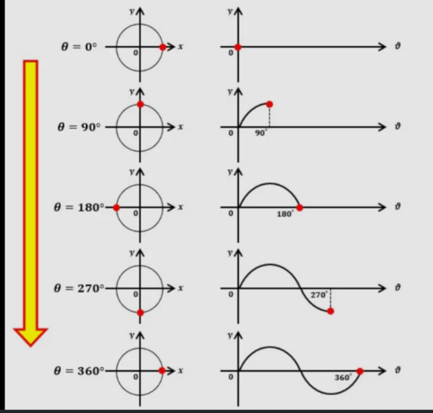

# 単位円と三角関数

- 前節では、直角三角形を用いて三角関数の定義を説明しましたが、これでは90度を超える角度を扱うことができません。そのため、少し拡張した話をしましょう。鍵となるのが**単位円**（半径1の円）です。
- グラフ上に単位円を書きます（下図）。次に、単位円上の任意の点Pをとって、点Pとグラフの原点までを結びます。また、点Pからx軸まで垂線を下ろします。そうすると、斜辺の長さが 1の直角三角形ができます。
- x軸と斜辺のなす角度をθとしたとき、点Pのx座標はcosθ、y座標はsinθで表すことができます。これは、前節での三角関数の定義における、cが1になったパターンで、言っていること自体は同じです。
    
    
    

- 単位円を用いた定義を用いることで、点Pを左回りに回転させて、θが90度を超えても、三角関数の値が決まります。角度がぐるぐる回るにつれて、sinとcosの値は、-1から1の間を規則的に行き来する「波」を描きます（下図2枚目。sinのグラフ）。
    
    
    
    
    
