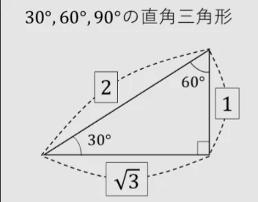
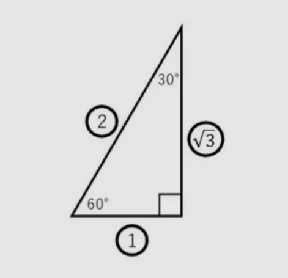
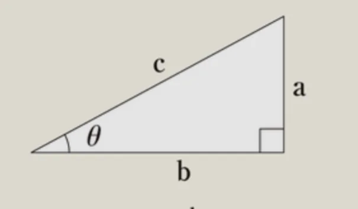

# 練習問題

この章（三角関数）の練習問題をまとめたものです。

## 三角関数の波（MA10-03）

- 問題
    
    ①以下の直角三角形において、sin30°、cos30°、tan30°の値を求めよ。
    
    
    
    ②上の直角三角形において、sin60°、cos60°、tan60°の値を求めよ。
    
    ③八広駅からスカイツリーまでは3km離れている。駅からスカイツリーの先端を見上げたところ、地面とのなす角が 12°であった。この情報をもとに、スカイツリーの高さを計算して求めよ。なお、必要ならば、tan12° ≒ 0.213であることを使ってもよい。
    
- 解答
    - ①
        
        （答）順に、1/2, √3/2, 1/√3
        
        （解説）公式を用いて計算する。
        
    - ②
        
        （答）順に、√3/2, 1/2 , √3
        
        （解説）以下の図のようにして考えるとわかりやすい。
        
        
        
    - ③
        
        （答）639m
        
        （解説）八広駅とスカイツリーの関係を以下のように直角三角形として捉える。aがスカイツリーだとしよう。bはスカイツリーまでの距離（3km）で、θが12°である。知りたいのはaの長さである。cは今回は使わない。tanθ = a / b を使うと、tan12° = a / 3000（m）である。問題文より、tan12° = 0.213であることを使うと、a = 639mとなり、これでスカイツリーの高さを概算することができた。
        
        
