# 微分の考え方

- 車が走っているとき「**今この瞬間の速さ**」は、どうやって測るのでしょうか。スピードメーターを見れば分かりますが、数学的にはどう定義するのでしょうか。
- 速さは「ある時間内に進んだ距離 ÷ 時間」で計算できます。例えば、5分で20km進んだなら、20 ÷ 5 で、分速4km（時速240km）です。
- しかし、これは「5分間の平均の速さ」です。「今この瞬間の速さ」を求めるには、時間の間隔をどんどん短くして 0 に近づける、すなわち極限を取る必要があります。この発想を式で表したものが、**微分**の定義です。
- 実際に微分をしてみましょう。x分かけて移動した累計の距離を f（x）とします。
    
    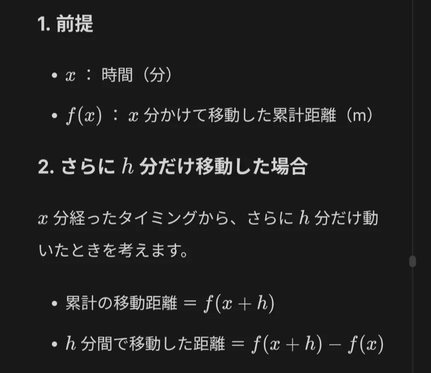
    
    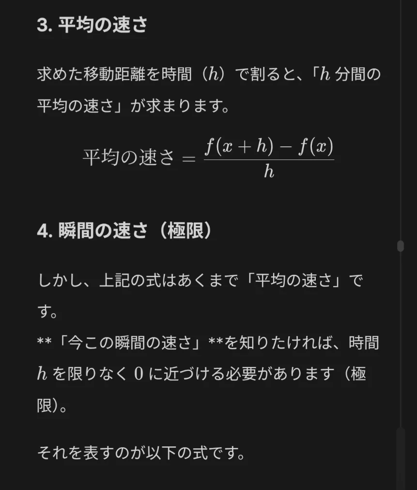
    
    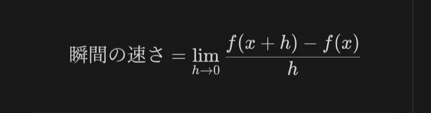
    
- 上のようにして求まった「瞬間の速さ」を、**導関数**（**f’(x)**と表す）と呼び、f(x)から導関数を求めることを「**微分**する」と呼びます。
- 実は、微分というのは、グラフの傾きを求めるのと同じ行為です。2x を定義に従って微分すると、「2」という数字が、5x なら「5」という数字が導関数として出てきます。
- 2x のような簡単な一次関数なら、わざわざ微分を使うまでもなく傾きを求めることができますが、2次関数ならどうでしょうか。そもそも場所によって傾きが異なる上、一次関数のように式から傾きが読み取れるわけでもないため、これを算出することは容易ではありません。
    
    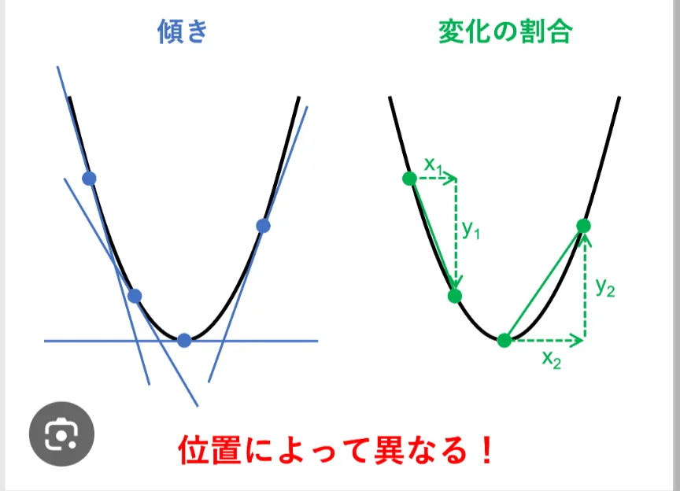
    
- このようなときに用いられるのが微分です。先ほどの定義に従って計算すれば、どんな形の関数であっても、任意のxにおける傾きを求めることができます。

- 問題
    
    ① 1, 1/2, 1/4, 1/8, … と続いていく数列がある。この数列の第n項までの和を、等比数列の和の公式を用いて式で表せ。また、第∞項までの和を、極限を使って表せ。
    
    ② 上の数列の無限和（∞項までの和）はいくつになるか。値を求めよ。
    
    ③ 高いところからボールを落とす。このとき、落ちた距離を x 、かかった時間を t とすると、x = 5t² であることが知られている。この式の導関数を求めよ。
    
    ④ ボールを離してから、1秒後のボールの速度を求めよ。
    
    ⑤ ボールの速度は、重力によって毎秒速くなっていく。1秒あたり何m/sずつ速くなるかを求めよ。
    
- 解答
    - ①
        
        （答）
        
        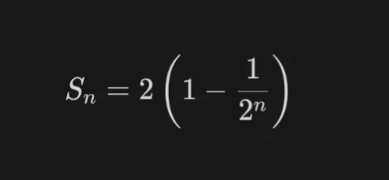
        
        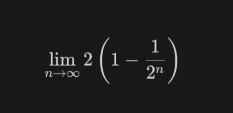
        
        （解説）初項1, 項数n, 公比1/2を、公式に当てはめればよい。
        
        極限は、limをつけて表すだけである。
        
    - ②
        
        （答）2
        
        （解説）①で極限の式を立てたので、後はこれがどのような値を取るか考える。
        
        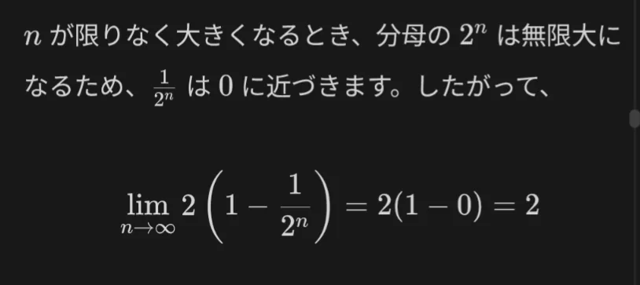
        
    - ③
        
        （答）10t
        
        （解説）
        
        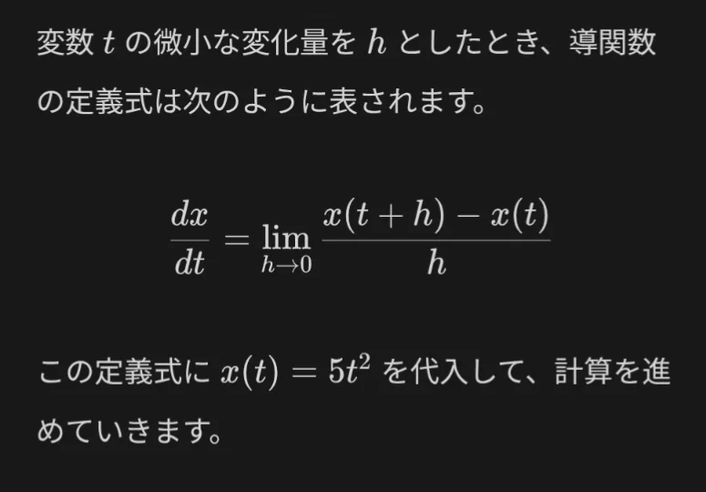
        
        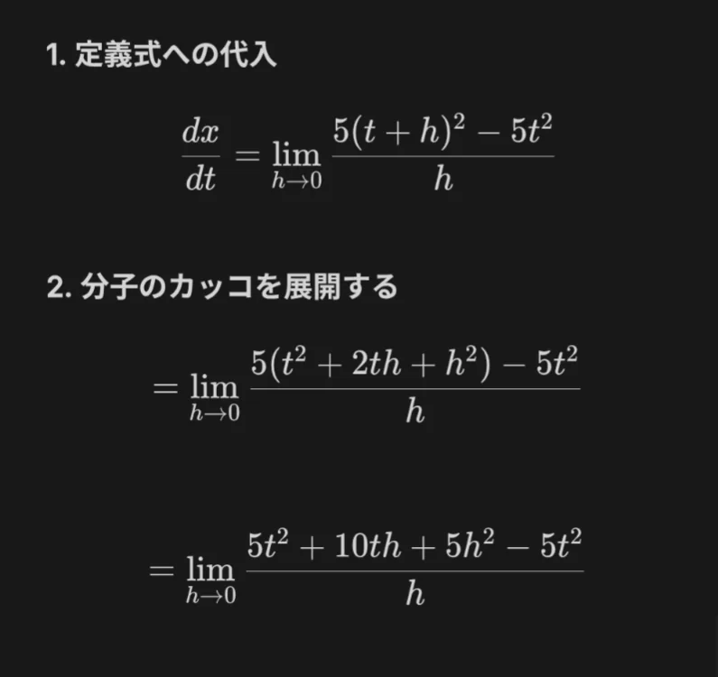
        
        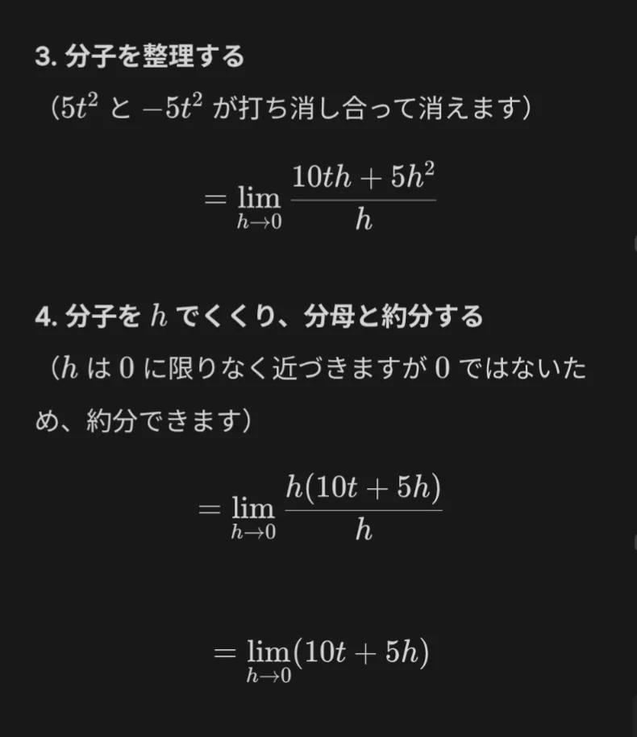
        
        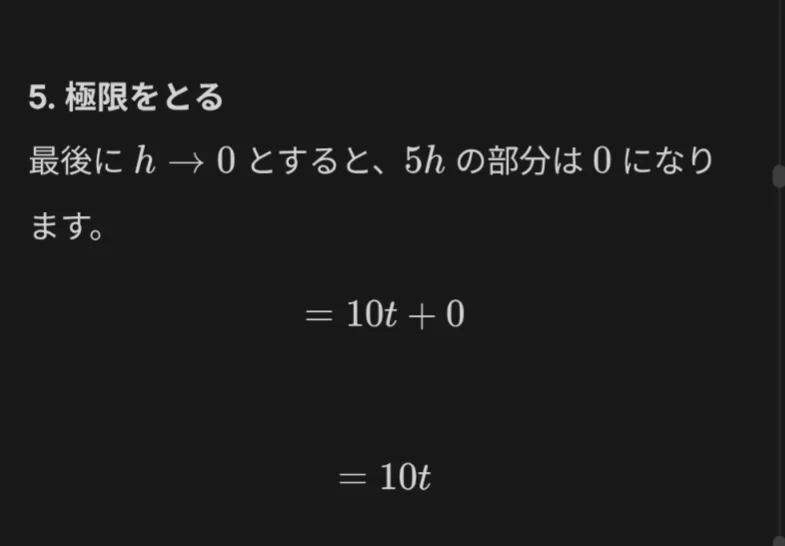
        
    - ④
        
        （答）10m/s
        
        （解説）③より、導関数が10tであることがわかっている。これは、導関数は、落下距離 x のグラフの傾き（変化量）、すなわち「速さ」を意味する概念である。１秒後の速さを知りたいので、t = 1を代入すると、10。すなわち、1秒後の速さは10m/sである。
        
    - ⑤
        
        （答）10m/s
        
        （解説）④で求めた10tは、t 秒後の速さを表す式である。今回知りたいのは、この「速さ」がどれだけ変化するか（変化量）なので、傾きを見れば良い。すなわち、10である。よって、ボールの落ちる速度は、毎秒10mずつ速くなっていくことがわかる。
        
