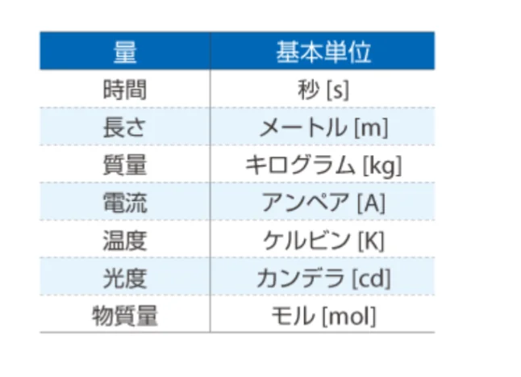
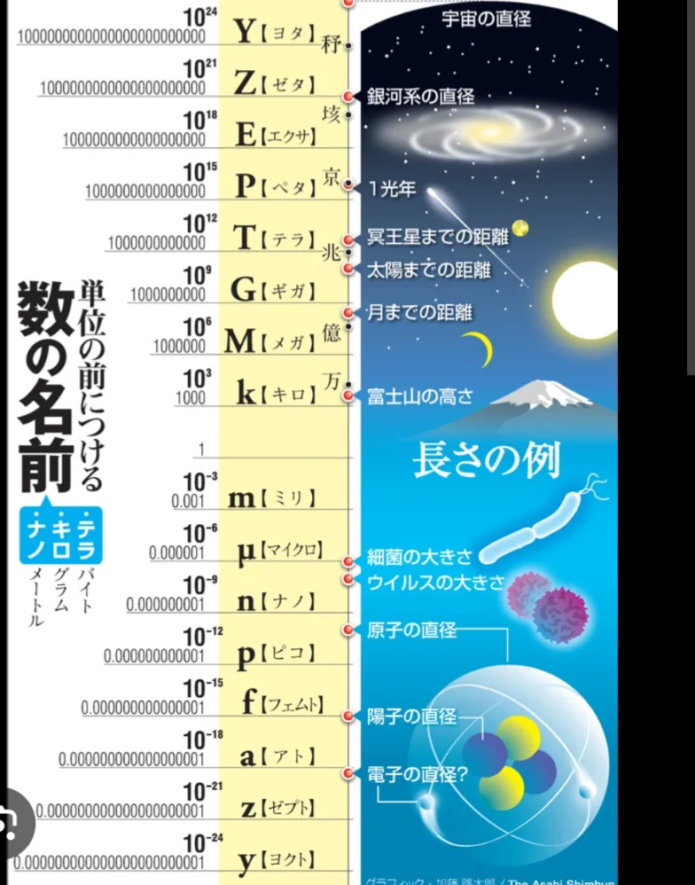

# 単位と測定

- 物理では数値だけでなく「**単位**」が必ずセットで必要です。「速さが10」では意味がなく、「時速10km」か「秒速10m」かによって、全く違う意味になります。
- 国際的に統一された単位系を**SI単位系**といい、七つの基本単位があります。
    
    
    

- この七つを組み合わせると**あらゆる単位が作れます**。
    - 速さは m/s（メートル毎秒）
    - 力は kg・m/s²（これを**ニュートン**：Nと呼ぶ）
    - エネルギーは kg・m²/s²（これを**ジュール**：Jと呼ぶ）
- 単位を見るだけでその量の正体がわかります。「km/h」はkm（距離）をh（時間）で割ったものだから、「距離÷時間＝速さ」だとわかります。
- **接頭辞**も重要です。kは1000倍、M（メガ）は100万倍、m（ミリ）は1000分の1、μ（マイクロ）は100万分の1 です。
    - 1km＝1000m、1ms（ミリ秒）＝0.001秒というように使います。
    
    
    
