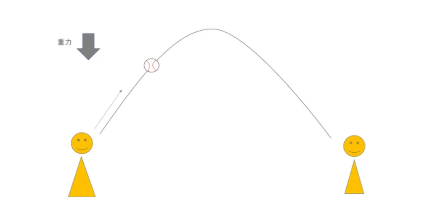

# 重力と落下運動

- **重力**とは地球が物体を引っ張る力です。質量mの物体に働く重力の大きさは **mg**（mは質量、gは重力加速度）です。これを「**重さ**」と呼びます。
- 「質量」と「重さ」は日常語では混同されますが物理では別物です。**質量**は物体固有の量で**場所が変わっても変わりません**。**重さ**は、物質にかかる重力の大きさのことなので、**場所によって変わります**。
    - 月面では重力が地球の約6分の1になるので、体重計の値（重さ）は6分の1になりますが、我々自身の体（質量）に何か変化があったわけではありません。
- 物体をまっすぐ下に落とすことを**自由落下**といいます。すべての物体が同じ加速度（g）で落下します。**重いものも軽いものも同じ速さで落ちる**ということです。
    - これを最初に実証したとされるのがガリレオで、ピサの斜塔から重さの違う球を落としたという伝説があります（実際にやったかは不明）。
- 物を横に投げると**放物線運動**を描きます。
    - 水平方向は等速直線運動、垂直方向は自由落下、この二つが同時に起きた結果が放物線です。
    
    
    
