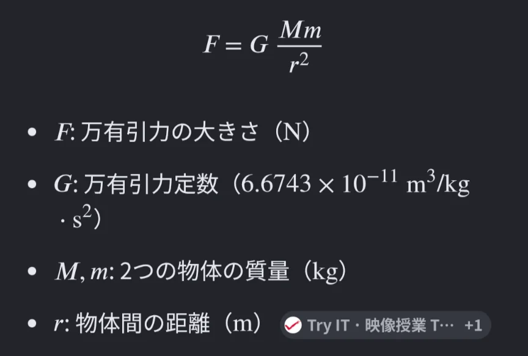
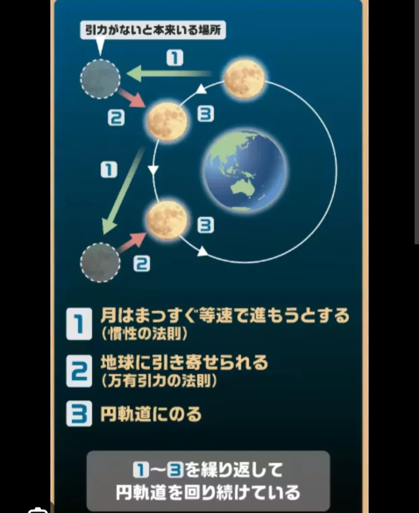

# 万有引力

- **ニュートン**がリンゴの落下を見て**万有引力**を発見した、という話は有名です。
    - 事実かは怪しいですが、「なぜリンゴは落ちるのに月は落ちないのか」という問いが研究のきっかけになったのは確かなようです。
- ニュートンが発見した**万有引力の法則**は、「すべての物体は互いに引き合う」というもので、下図のように公式化されています。
    
    
    
- **万有引力定数**は非常に小さな数なため、日常の物体間では引力はほぼゼロです。しかし、地球のように質量が巨大になると引力が強くなり、これが重力の原因になっています。
    - ちなみに、地球上の物質は万有引力によって地球に引っ張られていますが、同時に自転による**遠心力**によって外側方向への力もかかっています。万有引力から遠心力を引いた、**実際にかかっている力のことを重力**と呼んでいます。
- 月はなぜ落ちてこないのでしょうか。実は月も地球に向かって「落ちて」います（下図）。
    
    
    
