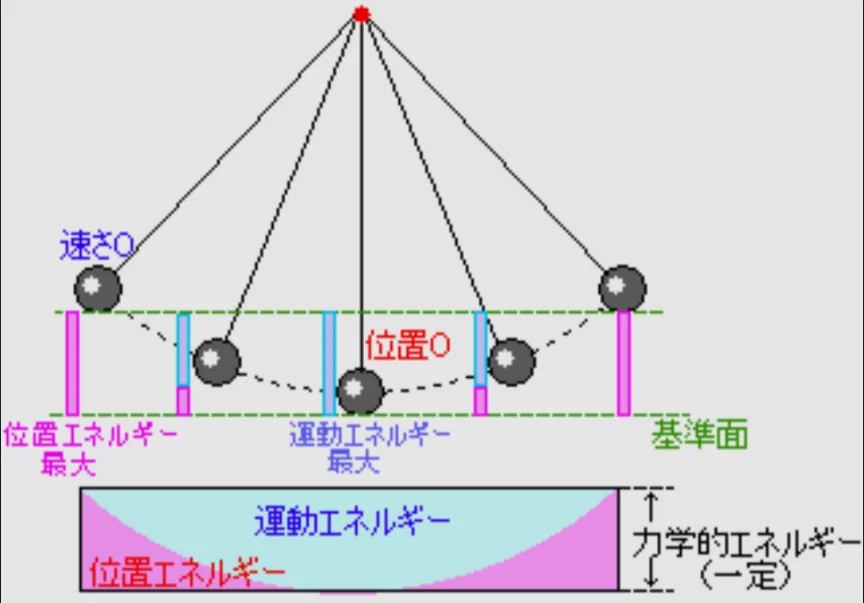

# エネルギー保存の法則

- 物理で最も重要な法則の一つが、**エネルギー保存の法則**です。簡単に言うと、「エネルギーの総量は変わらない」という法則です。
- 振り子を例にして考えてみましょう（下図参照）。最高点では速度（運動エネルギー）はゼロですが、位置エネルギーは最大になっています。一方、最下点では速度（運動エネルギー）は最大ですが、位置エネルギーは最低です。位置エネルギーと運動エネルギーが互いに変換され続け、その合計が常に一定となって運動を続けます。
    - 現実の振り子は摩擦・空気抵抗でだんだん振れ幅が小さくなります。エネルギーが「消えた」のではなく、摩擦熱によって熱エネルギーに変換され、空気中に逃げていったのです。
    
    
    
- 振り子を動かすためには、まず手で物体を持ち上げる必要があります。手を離すと、位置エネルギーが運動エネルギーに変化され、運動が始まります。では、はじめに生まれた位置エネルギーはどこから来たのでしょうか。物体は何の代償もなく位置エネルギーを得たわけではありません。手が物体を持ち上げる、すなわち仕事をした結果、位置エネルギーを獲得できているのです。
- このように、「仕事をする」という行為は、自分の持つエネルギーを消費して「ほかの物体にエネルギーを与える」という行為と同義だと解釈することができます。エネルギーを与えられた物体は仕事をすることで、さらにほかの物体にエネルギーを与え…というように、エネルギーと仕事は互いに変換されながら循環していきます。
- ただし、自分の持つエネルギーを100%仕事に変えて他の物質にあげることはできません。例えば、100度の熱湯を使って0度の水を温めることを考えます。その結果、50度の水が出来上がったとしましょう。このとき、熱湯だった液体はエネルギーを失った一方、0度の水はエネルギーを得たので、全体としてはエネルギーの総量は変わっていません（エネルギー保存則）。しかし、この50度の水を使って、再び0度の水を温めようとしても、50度まで温めることはできなくなっているでしょう。
- このように、物質が持つエネルギーは、全てを有効活用できる（仕事に変換できる）わけではなく、一部のエネルギーは使えなくなってしまうのです。そのため、**永久機関**を作ることはできません。
    - 永久機関とは、仕事をして生まれたエネルギーを使って更に仕事をし、またエネルギーを与え、という動作を繰り返すことで無限に仕事ができる（エネルギーを生み出せる）機械です。
    - 歴史上、無数の永久機関（の候補）が発明されましたが、すべて失敗しています。
- 100%のエネルギーを使うことはできないにしても、エネルギーを使用することは我々人類にとって有用です。例えば、電球は電気的なエネルギーを光のエネルギーに変えることで光っています。その過程で、一部のエネルギーが熱に変わって空気中に逃げてしまいますが、それでも電球というものは有用です。
