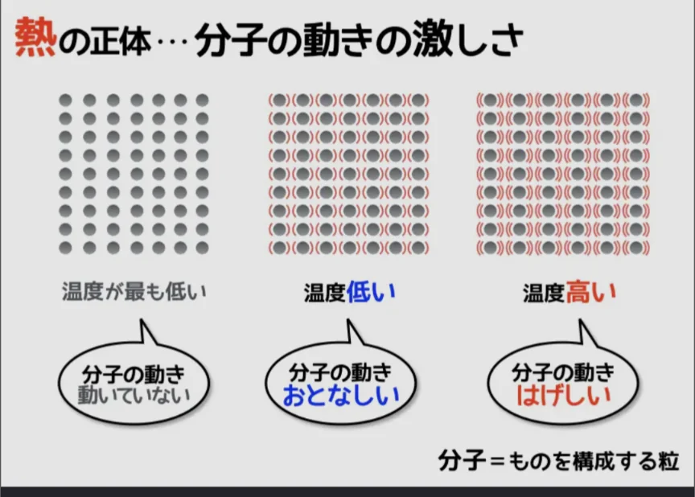
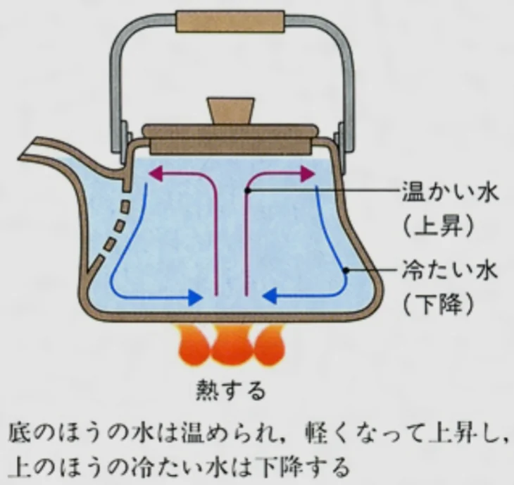

# 熱とエネルギー

- 「**熱**」の正体は**分子の運動エネルギー**です。「物体の温度が高い」ということは、その物体を構成する分子・原子が激しく振動・運動しているということです。
    
    
    
- 分子の一つ一つは、どれも全く同じ速さで動いているわけでななく、**すべてがバラバラ**です。そのため、その激しさの平均を「**温度**」を使って表します。
    - 摂氏（℃）は氷が溶けるときの分子の動きの激しさを0、水が水蒸気に変わるときの激しさを100として定めた単位です。
    - 物理や化学でよく使う**ケルビン**（K）は絶対温度とも呼ばれ、分子の運動が完全に止まる状態（理論上の最低温度）を0とします。0Kは、-273.15℃です。これ以下の温度は存在しません（**絶対零度**）。
- 熱は、温度差があるときに自発的に移動します。具体的には、温度の高い物体から低い物体へ、一方的に移動します。逆向き（冷たいものから熱いものへ）は自然には起きません。
- 熱が移動する方法は3種類あります。
    - **伝導**：物質を通じて熱が伝わる（金属の棒の端を熱すると反対側も熱くなる）。
    - **対流**：液体・気体が動いて熱を運ぶ（底で温められた水は上に上がる。逆に上の方にある冷たい水は下に移動していき、温められることで再度上に移動し、循環が起きる）。
        
        
        
    - **放射**：物質を介していなくても電磁波として熱が直接伝わる（太陽の熱が真空の宇宙を越えて地球に届く）
- 問題
    
    ① 高さ5mの場所から、50gのボールを落下させる。地面に着く寸前のボールの速さを求めよ。ただし、重力加速度は、10m/s²としてよい。
    
- 解答
    - ①
        
        （答）10m/s
        
        （解説）エネルギー保存則を用いる。ボールが落ちる前、保持している位置エネルギーは、mgh = 50 × 10 × 5 = 2500である。
        
        ボールが地面に着く寸前は、位置エネルギーは0になり、運動エネルギーのみがある。運動エネルギーは、ボールの速度をvとしたとき、mv²/2 = 50 × v² / 2 = 25v²である。
        
        ボールが落ちる前の位置エネルギーと、落ちた後の運動エネルギーは等しくなる（エネルギー保存）ため、2500 = 25v²、すなわち、v = 10である。
        
