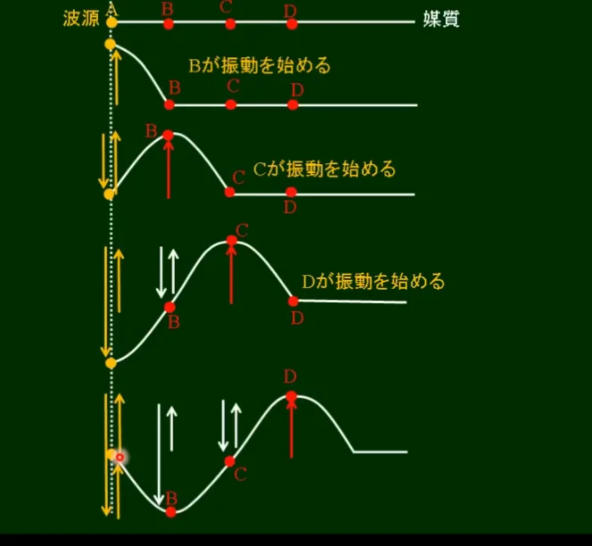
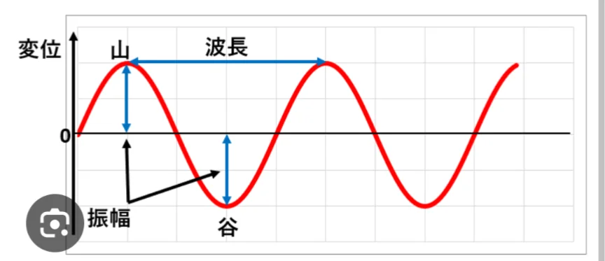
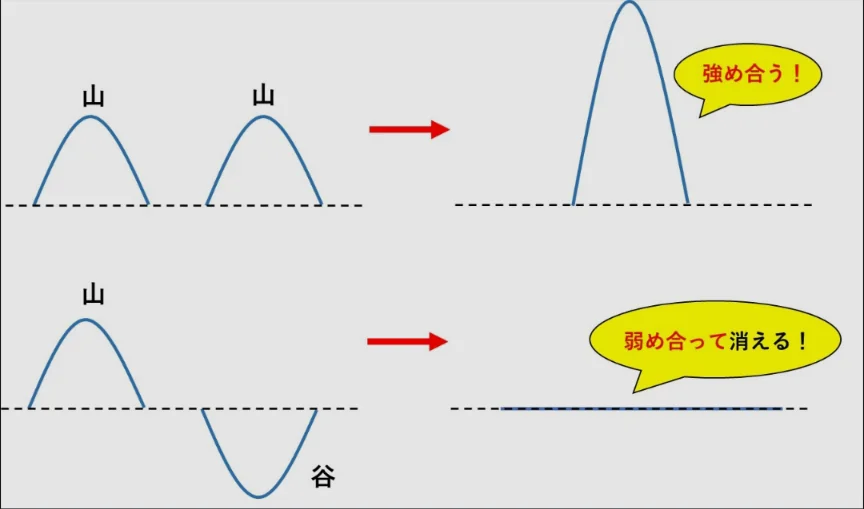

# 波とは何か

- **波**とは、「振動が次々と伝わっていく現象」です。
    - 水面に石を投げると波紋（波）が広がります。これは、水そのものが移動していっているわけではなく、上下に振動する動きが伝わっているのです。
    
    
    
- 波を表す基本的な用語を整理します。
    - **振幅**（しんぷく）：振動の大きさ（波の高さ）→音なら大きさ、光なら明るさに対応します。
    - **波長**：隣り合う山（または谷）の間隔。
    - **振動数（周波数）**：1秒間に振動する回数。単位はHz（ヘルツ）。
    
    
    

- 波の重要な性質として**重ね合わせ**（**干渉**）があります。二つの波が重なると足し合わされます。山と山が重なると大きな山に、山と谷が重なると打ち消し合います。
    - ノイズキャンセリングイヤホンはこの「打ち消し合い」を人工的に作り出して雑音を消す技術です
    
    
    
