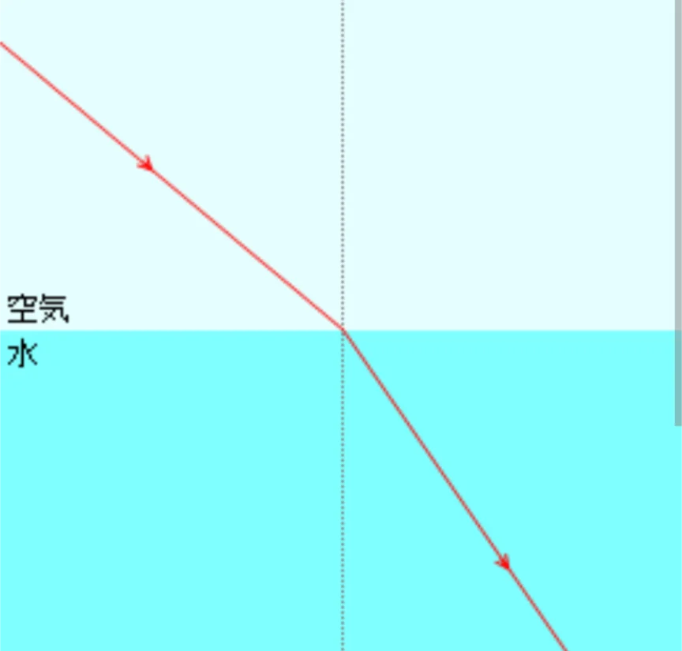
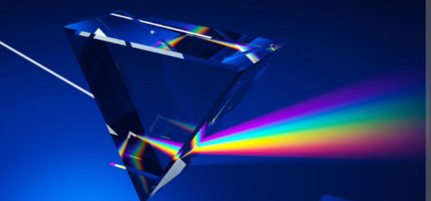

# 光の性質

- **光**は、真空中を約30万km/sで進む電磁波（後述）であり、これもまた波の一種です。
    - 光は宇宙で最速で、何ものもこれを超えられないことが知られています。
- 異なる物質の境界で、光が進む方向が曲がる現象を**屈折**と呼びます。
    - 水の中に棒を入れると折れて見えるのは屈折のためです。
    
    
    

- 白色光が**プリズム**などで複数の色に分かれる現象を**分散**と呼びます。**光は、波長の大きさによって色が変わる**のですが、それぞれ屈折の度合いが違うために、屈折を経ることで色ごとに分かれて見えるのです。
    - 虹は空気中の水滴がプリズムの役割を果たして太陽光を分散させた現象です。
    
    
    
