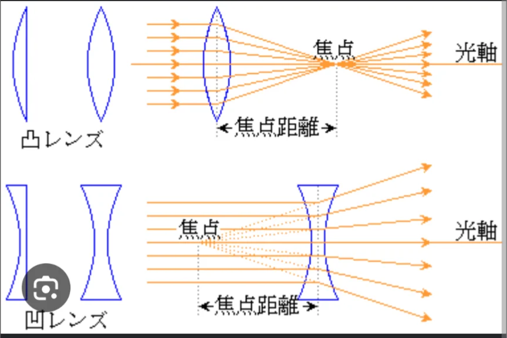
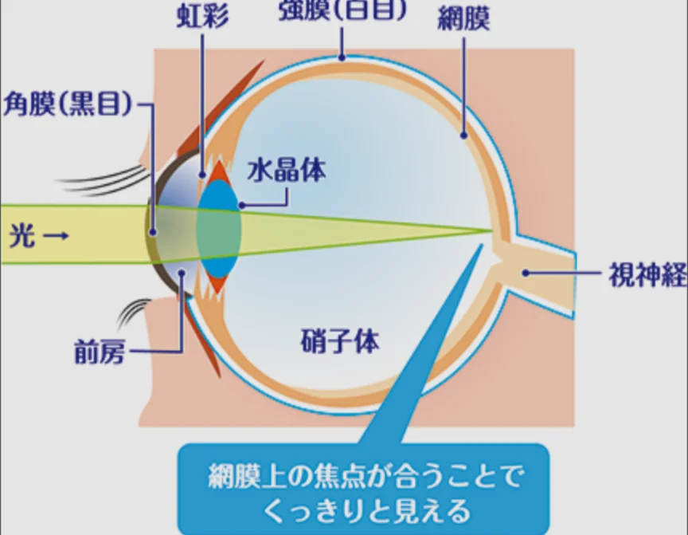

# レンズと光学機器

- **レンズ**は光の屈折を利用して光の進み方をコントロールする道具です。光の集まる場所を**焦点**といいます。
    
    
    

- **凸レンズ**は中央が厚いレンズで、平行に入った光を一点（焦点）に集めます。
    - 虫眼鏡・カメラのレンズ・望遠鏡の対物レンズが凸レンズです。太陽光を虫眼鏡で集めると紙が燃えるのは、光のエネルギーが一点に集中するためです。
- **凹レンズ**は中央が薄いレンズで、光を広げる方向に屈折させます。近視用のメガネに使われます。
- **目**の仕組みも光学の応用です。目の水晶体（凸レンズ）が網膜に像を結ぶことで、物体を「見る」ことができます。
    
    
    
