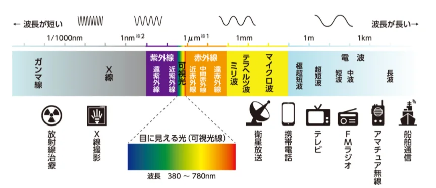

# 電磁波とその種類

- **光**は、電磁波の一種です。**電磁波**とは、電場と磁場（後述）が振動しながら伝わる波のことです。
- 電磁波の種類は、波長によって分類されます。これらはすべて「同じ種類の波」で、違いは波長だけです。波長が短いほどエネルギーが大きくなります。そのため、**X線**や**γ線**は体を透過し、組織を傷つける力があります。
    - 電子レンジはマイクロ波（電波の一種）を使って食品中の水分子を振動させて発熱させます。WiFiも同じマイクロ波の帯域を使っているため、WiFiルーターの近くで電子レンジを使うと通信が乱れることがあります。
    
    
    
