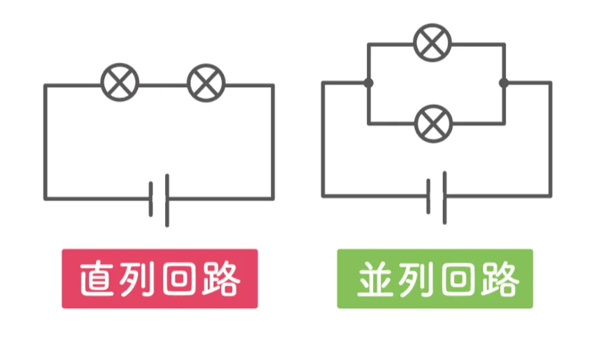

# オームの法則と回路

- 電圧、電流、抵抗の関係を表す基本法則が、**オームの法則**です。
    - V = IR（電圧＝電流×抵抗）
    - 電圧が大きいほど電流が多く流れ、抵抗が大きいほど電流が流れにくい、ということを表しています。
- 電気回路には、二つの基本的なつなぎ方があります。**直列回路**は部品を一列につないだ回路です。電流の経路が一つなので、どこでも同じ電流が流れます。一か所切れると全体が止まります。
    - 古いクリスマスツリーの電球が一個切れると全部消えるのはこのためです。
- **並列回路**は、部品を複数の経路に分けてつないだ回路です。各経路に電流が分かれて流れ、一か所切れても他の経路は生きています。家庭のコンセントは並列回路で、電子レンジが壊れても照明は消えません。
    
    
    

- 電気製品の単位時間あたりの**消費電力**は、P＝RI²（抵抗×電流²）で計算できます。
    - 電流が抵抗の中を流れる際、電子が抵抗にぶつかることで、熱（**ジュール熱**）が発生します。電気製品は、この熱エネルギーを使って動作しています。そのため、消費電力の式には抵抗と電流が共に登場するのです。
