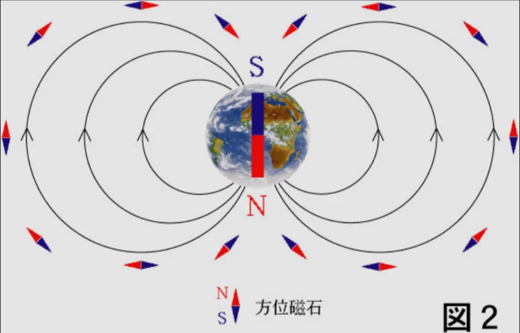
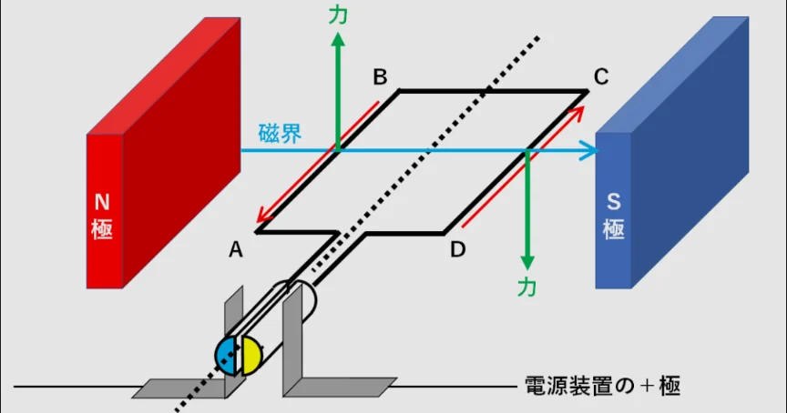
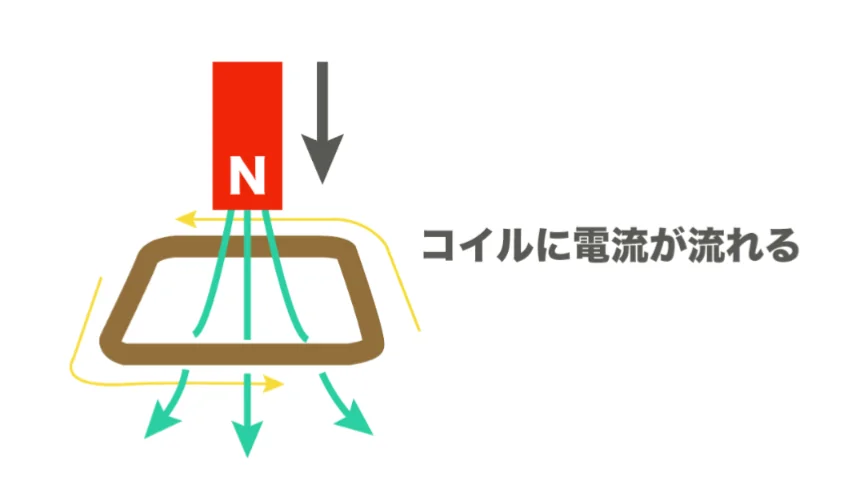

# 磁気と電磁誘導

- **磁石**は、N極とS極を持ち、同じ極同士は反発し、異なる極は引き合います。磁石の力が及ぶ空間を**磁場**と呼びます。
- 方位磁針のN極が常に北を向くのは、北極付近にS極、南極付近にN極があるというように、地球自体が一つの大きな磁石のようになっているためです。それによって生まれる地球の磁場は、太陽からの有害な粒子（**太陽風**）から地表を守るシールドになっています。
    
    
    
- 電流と磁気は深く関係しています。 電流が流れると、それだけで勝手に周りに磁場が発生します。また、磁場の中で電流が流れると**アンペール力**と呼ばれる力を受けます。
    - 電気モーターは、磁石に挟まれた電線に電流を流し、アンペール力を生み出すことで、回転しています。
        
        
        
- 上の逆で、磁場が変化させると、それだけで勝手に電流が流れ始めます。この現象を**電磁誘導**と呼びます。**ファラデー**が発見したこの現象は、電磁調理器（IH）や自動改札の原理になっています。
    - IHコンロは、内部のコイルに交流の電流を流して、向きが変化し続ける磁場をつくります。その上に置いた鉄などの鍋の底に電磁誘導で電流（うず電流）が流れ、鍋の抵抗で発熱（ジュール熱）させています。
    
    
    
