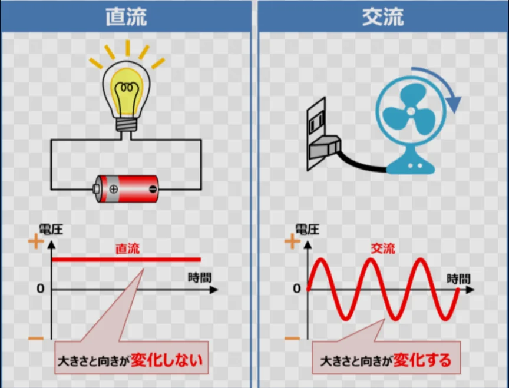

# 発電と送電

- 発電所から家庭に電気を届ける**送電**では、電圧を高く（数十万V）して送ります。
    - 消費電力の式から分かる通り、電圧が高くなると、電線での電力損失（熱として失われるエネルギー）が減るためです。
- 発電所から送られてくるのは**交流**（**AC**）と呼ばれる電気で、**電流の向きが周期的に変化**します。普通の電気（**直流**。**DC**）よりも、高電圧に変えやすいという特徴があるため、よく使われています。
    - 家庭では変圧器で100Vに下げてから電気を使います。充電器に使われるアダプタはACをDCに変換する機器です。
    
    
    
