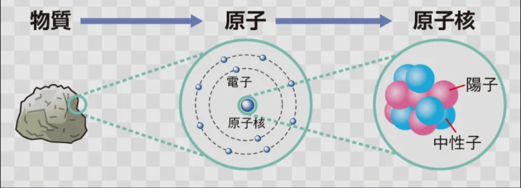

# 原子の構造と原子核

- **原子**は、中心の**原子核**（**陽子**＋**中性子**）と、周りを回る**電子**からできています。
    - 陽子の数は原子番号に対応し、元素の種類を決めるものです。例えば、陽子が1つなら水素、2つならヘリウムになります。
    - 原子核の大きさは原子全体の約10万分の1です。原子を東京ドームの大きさとすると、原子核はその中のビー玉一個ほどです。原子のほとんどは「空っぽ」です。
    
    
    
- 陽子の数が同じ（元素が同じ）でも、中性子の数が違う原子のことを**同位体**と呼びます。
    - 例えば、水素の場合、通常の水素（陽子1個＋中性子0個）に加えて、以下のような2種類の同位体があります。
        - **重水素**（陽子1個＋中性子1個）
        - 三重水素（陽子1個＋中性子2個）
- 同位体は、同じ元素なので化学的性質はほとんど同じですが、質量が必要以上に大きくなり、一部の同位体は不安定になります。そのため、余分なもの（**放射線**）を出し、より安定な他の物質に変わろうとします（**崩壊**）。これを**放射性同位体**と呼びます。
