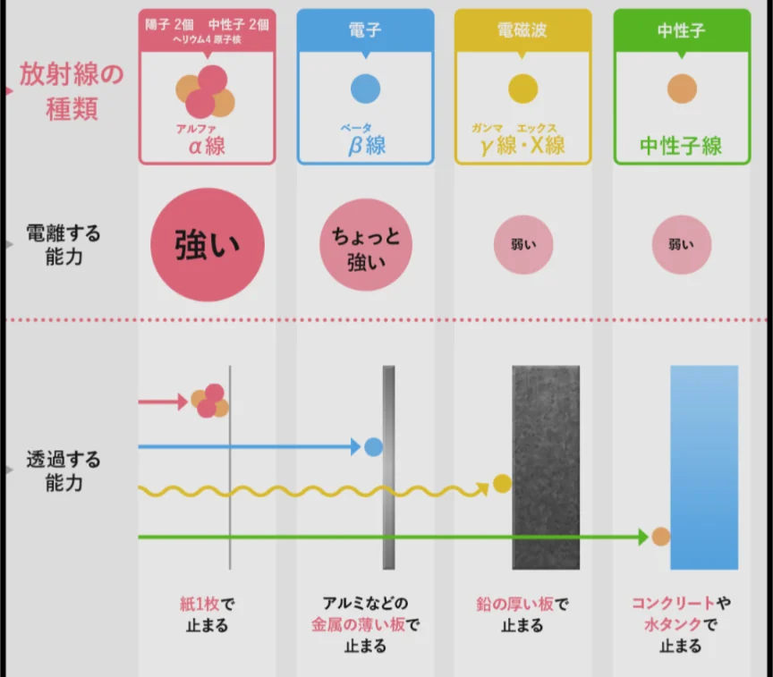

# 放射線の種類と性質

- 放射性同位体が崩壊するに伴って出てくる粒子・電磁波を**放射線**と呼びます。放射線は電磁波の一種で、体への影響は、照射量・照射時間・種類によって異なります。
    
    
    
- 放射線は自然界にも存在します。**宇宙線**や、地面から出るラドンガス、食品中の放射性カリウムなど、人間は常に微量の放射線を浴びています。
- 放射線の医療応用も重要です。レントゲンやCTは、ともに放射線を使った診断法です。また、その透過性を利用して、がん細胞を放射線で破壊する治療法もあります。
