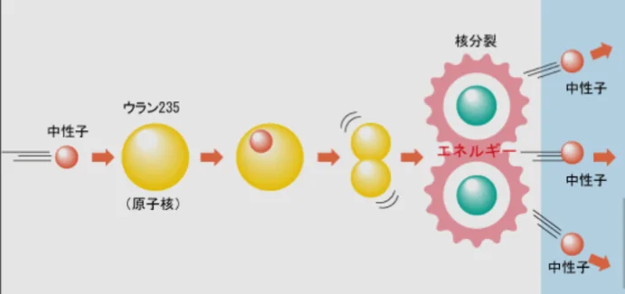
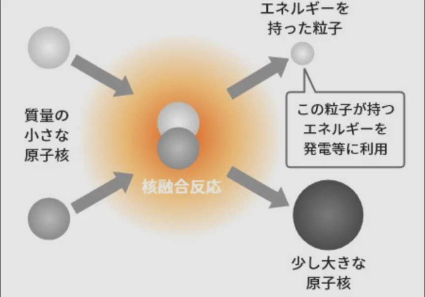

# 核分裂と核融合

- 崩壊のような反応は、通常の化学反応とは**桁違いのエネルギー**を生み出します。
- 通常の化学反応では、物質の質量が変わることはありません（**質量保存**の法則）。ただ、物質同士がくっついたり離れたりするだけです。一方で、放射性同位体などは、質量を減らし、その分をエネルギーとして生み出す反応（**核分裂**や**核融合**）を起こします。
- **核分裂**は、ウランやプルトニウムなど、重くて不安定な原子が分裂して小さな原子になる反応です。分裂後の質量の合計は分裂前より少なく、その差がエネルギーとして放出されます。
    - **原子力発電**では、1個の核分裂が次の核分裂のトリガーとなり、連鎖反応を起こすで持続的にエネルギーを取り出しています。一方で、**原子爆弾**ではこれらを一気に爆発させることで、凄まじい破壊力をもたらします。
    
    
    
- 一方、**核融合は**、軽い原子（水素の同位体など）を高温・高圧で合体させて重い原子にする反応です。元の原子の総量よりもやや軽い原子核が生まれるため、その差がエネルギーとして放出されます。
    - 核分裂より大きなエネルギーが得られるうえ、燃料（重水素）は海水から豊富に取れ、核廃棄物も少ない。太陽が輝くのもこの核融合反応によるものです。「夢のエネルギー」と呼ばれますが、制御して持続させることが技術的に極めて難しく、現在も世界中で研究が続いています。
    
    
