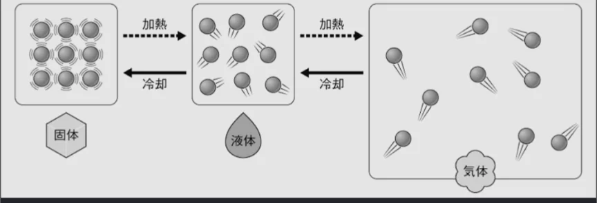

# 物質の三態

- 同じ物質でも、温度を変えると、固体・液体・気体という三つの異なる状態（三態）をとります。水なら、氷・水・水蒸気です。
- 温度を変えると状態が変わるのはなせでしょうか。物質は無数の**粒子**でできています。温度が高いほど、熱のエネルギーを貰った粒子の動きが激しくなり、それによって形が変わっていきます。
- **固体**では、粒子が規則正しく並んで少し揺れているだけですが、それを熱すると、粒子がある程度自由に動き回れる状態になれます。これが**液体**です。さらに熱すると気体になり、粒子がバラバラに飛び回りはじめます。
    
    
    
- 水を熱すると水蒸気になるのも同じ理屈です。水の粒子がバラバラになって外に出ていこうとする力が、**大気圧**を超えたとき、沸騰が起こります。
    - 富士山の頂上など気圧が低いところでは、100℃よりも低い温度で沸騰します。
- 注意してほしいのは、物質は必ずしも液体になるわけではないということです。熱すると、固体からいきなり気体になってしまう（**昇華**）ものもあります。**ドライアイス**などが良い例です。
    - バラバラになろうとする粒子の力が強すぎる（粒子間の繋がりが弱すぎる）ため、大気圧では抑えられず、すぐに気体になってしまうのです。
