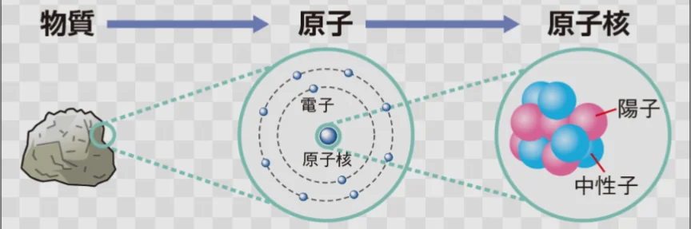
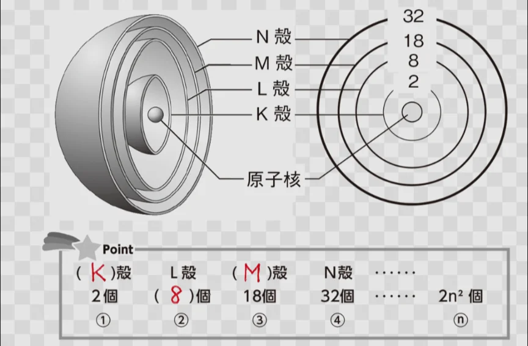
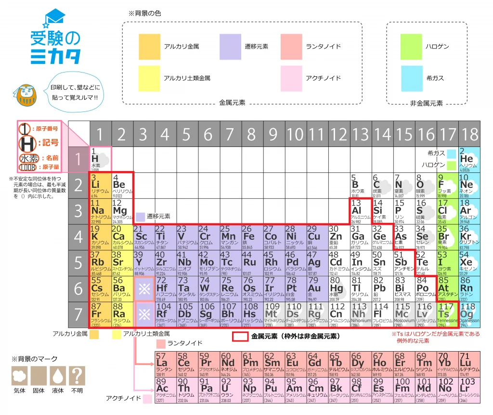

# 原子とは何か

- 物質を細かく分けていくと、それ以上化学的に分割できない最小の粒子になります。これが**原子**です。原子の大きさは1億分の1cm程度です。
- 原子は中心の**原子核**と、その周りを回る**電子**（e⁻）からできています。原子核はさらに**陽子**と**中性子**からできています。
    
    
    

- 電子はマイナス、陽子はプラスの電荷を持ちます。**電荷**というのは、物質が持つ電気のことです。中性子は電荷を持ちません。
- 陽子、電子、中性子の数にはそれぞれ意味があります。
    - 陽子の数：その元素が何かを決めます（**原子番号**）。
    - 電子の数：通常は陽子と同じ数で、電気的に中性になっています。
    - 中性子の数：同じ元素でも異なる場合があります（**同位体**）。同位体どうしは、重さは少しちがいますが、化学的な性質はほとんど同じです。
- **電子**は、原子核の周りの「**電子殻**」と呼ばれるいくつかの層に内側から配置されています。
- 一番内側の電子殻（K殻）には、電子は2個しか入れませんが、その1つ外側には.電子が8個まで入れるL殻があります。

- 一番外側の電子（**最外殻電子**）の数が、その原子の化学的性質を決めることが知られています。そのため、電子の数が違っても、最外殻電子数が同じであるような元素は似たような性質を持ちます。
- **周期表**においては、最外殻電子数が同じ元素が縦に並ぶように配置されており、一目で性質がわかるようになっています。
    
    
    
- また、最外殻電子が8個（または2個）になると元素の振る舞いが安定することが知られています（**オクテット則**。後述）。
