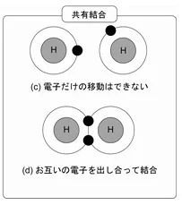
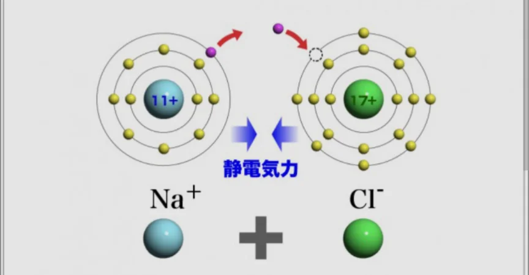

# 分子とイオン

- 最外殻電子数が8個でない原子は、オクテット則を満たしていないので、安定な状態になるために**化学反応**を起こします。
- 最外殻電子が7個であるCl（塩素）を例に考えてみましょう。電子数を8個にする方法として、一番簡単なのはCl同士でくっついてしまうことです（Cl₂）。7個目の電子をお互いに提供しあい、共有することによって、最外殻電子数が8個であるような状態を擬似的に作ることができます。
- このような結合（**共有結合**）によって生まれる粒子を、「**分子**」と呼びます。以下の画像はH₂の例です。最外殻電子数が2個でも安定な状態になれます。
    
    
    
- 一方で、ほかの原子から電子を奪う方法もあります。例えば、Na（ナトリウム）は最外殻電子数が1個です。オクテット則を満たしていないため、余っている電子を取り除きたいと思っています。
- ここに、電子が1個足りていない状態のClが来るとどうなるでしょうか。Naの電子をClが貰うことでどちらもオクテット則を満たすことができます。
    
    
    
- このとき、Clは電子が1つ増えるため、電荷がマイナスになります（Cl⁻）。逆に、Naは電子が1つ減るため、電荷がプラスになります（Na⁺）。プラスとマイナスが引かれ合い、両者はくっついて、NaCl（食塩。塩化ナトリウム）に変わります。
- 電荷を持っている状態の原子（Na+ や Cl⁻など）を「**イオン**」と呼びます。そのため、このような結合は**イオン結合**と呼ばれます。
    - **電解質**（スポーツドリンクに含まれるナトリウム・カリウム・カルシウムなど）はすべてイオンの形で働いています。
