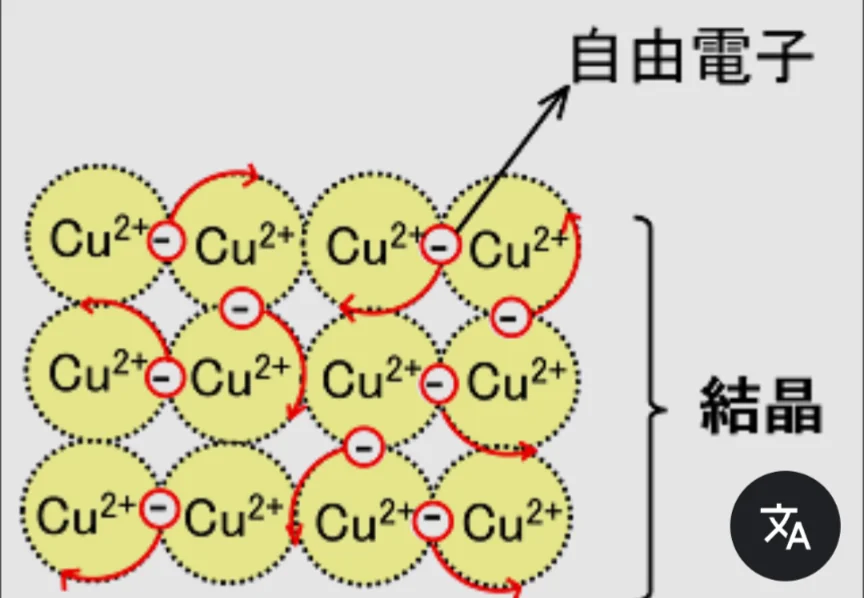

# 化学結合の種類

- 原子同士が結びつく方法には主に三種類あります。先述した共有結合とイオン結合、そして**金属結合**です。
- **共有結合**は非金属同士でよく起きます。
- **イオン結合**は非金属と金属の組み合わせでよく起きます。
- **金属結合**は金属同士の組み合わせで起きる結合です。
    - ちなみに、周期表を見てみると、非金属が極めて少ないことがわかります。元素が全部で118個見つかっているうち、非金属はたった22個です。
- 金属結合では、金属間を自由に動ける電子（**自由電子**）が存在し、これが電気伝導性・熱伝導性・光沢・延性（伸ばせる性質）・展性（叩いて広げられる性質）をもたらしています。
    - 銅などの金属が電線に使われるのは自由電子が電気を効率よく運ぶためです。
    
    
    
