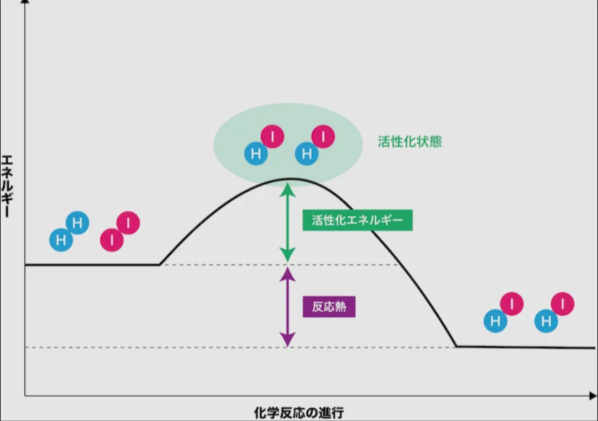

# 反応速度と触媒

- 木が燃える、という反応は日常的に起きやすい反応ですが、常温で勝手に燃えることはありません。反応を起こすには「**活性化エネルギー**」という最初の山を越える必要があるためです。
    
    
    
- 反応の速度を上げる要因としては、以下のようなものがあります。
    - 温度を上げる：粒子の動きが激しくなり衝突が増える
    - 表面積を増やす：固体の場合、細かくすると反応する面積が増える（砂糖の塊より粉砂糖の方が溶けやすいのもこのため）
- 上記以外に、反応する速度を速めるものとして、**触媒**というものがあります。触媒は活性化エネルギーを下げるはたらきがあります。
