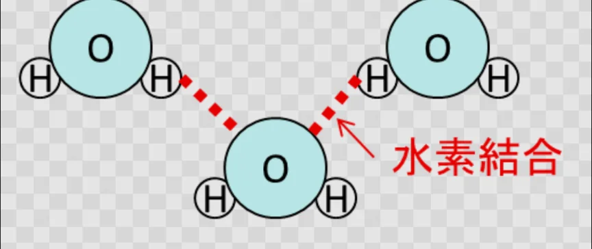
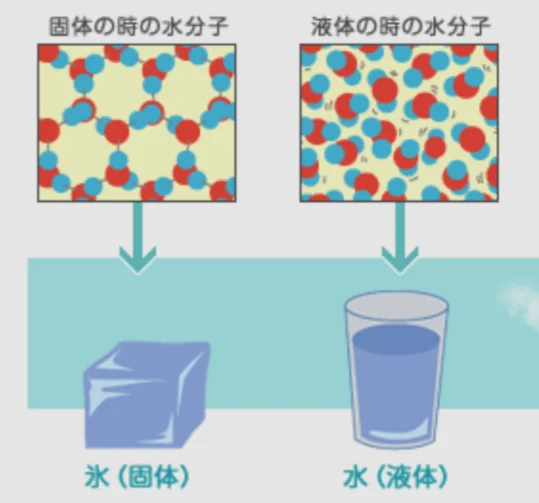
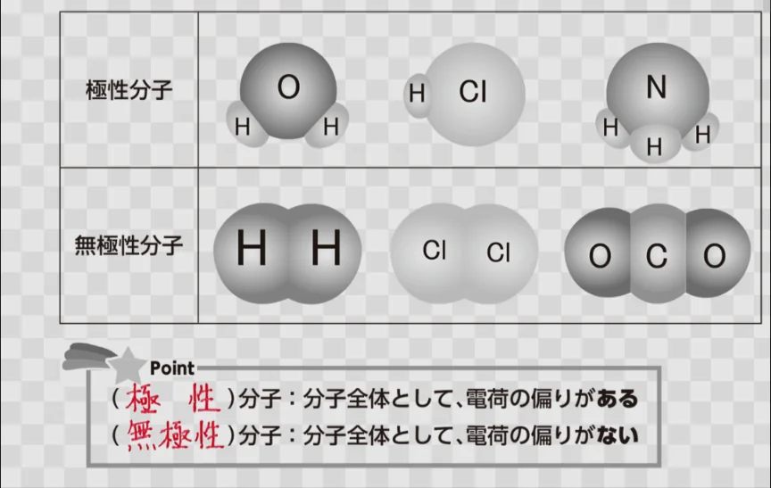
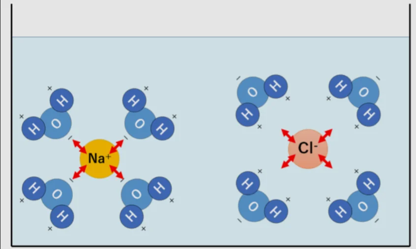

# 水の特別な性質

- 水は、化学的に見ると非常に特殊な物質です。**分子量**（分子の重さ）から予測される沸点は約-80℃のはずですが、実際は100℃。これは、水分子同士が**水素結合**という特別な引力で強く引き合っているためです。
- 水素結合とは、水分子中の水素原子（プラスの電荷）が、隣の水分子の酸素原子（マイナスの電荷）と引き合う結合のことです。
    - 通常の**分子間力**（分子の間に働く引力）より強く、水の沸点・融点・表面張力・比熱（温まりにくく冷めにくい性質）が、予想より高い理由です。
    
    
    
- 水に関する、最も身近な異常な性質が「氷が水に浮く」ことです。ほとんどの物質は、固体の方が液体より密度が高いため、固体が沈みますが、氷は水素結合の影響で水よりも密度が下がる（下図参照）ため、水に浮きます。
    
    
    
- 水は、「万能溶媒」と呼ばれ、様々な物を溶かすことができます。これは、水が**極性分子**だからです。
- **極性**というのは、電荷の偏りのことです。分子の結合の形によっては、一部の原子が偏ってプラスになっていたり、マイナスになっていることがあります。
    
    
    
- 水に塩などの極性分子を入れると溶けるのは、水もまた、極性分子だからです。水分子の中の酸素（マイナス）が、極性分子のプラスに偏っている部分を引きつけるため、極性分子がイオンになってバラバラになります。これが「溶ける」という状態です。
    - 一方、油などは極性を持たない（無極性分子）ので、水に溶けません。
    
    
    
