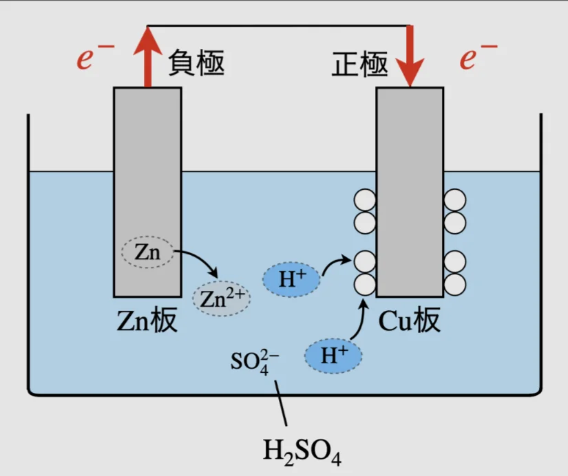

# 電池と電気分解

- **電池**は、化学反応を使って電気エネルギーを取り出す装置です。反応によって生まれる電子の流れを、電流として取り出します。
    - 乾電池（マンガン乾電池）では、中に含まれている亜鉛（Zn）が、Zn²⁺に変わるときに放出される電子が、回路を通ってマイナス極からプラス極に移動します。
    
    
    
- スマートフォンの**リチウムイオン電池**は、充放電の際にリチウムイオンが電極間を行き来する仕組みで、軽くてエネルギー密度が高いのが特徴です。

- 電池とは逆に、電気エネルギーを使って化学反応を起こすことを**電気分解**と呼びます。水に電気を流す（エネルギーを与える）ことで、水素と酸素に分解することができます。
- 電気分解の身近な応用として、アルミニウムの製錬があります。アルミは、**ボーキサイト**という鉱石に含まれており、電気分解で取り出すことができます。
    - アルミ缶のリサイクルが推奨されるのは、電気分解で新たに作るより大幅にエネルギーが節約できるためです。
