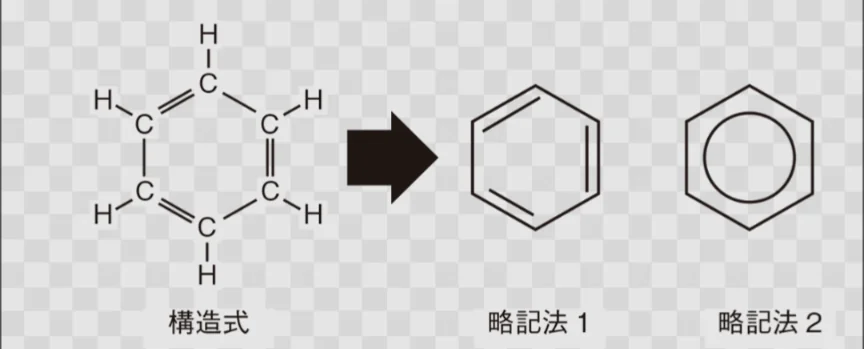

# 炭素と有機物

- **有機物**とは、炭素を含む化合物のことです。糖・タンパク質・脂質・DNA・プラスチック・アルコール・酢……私たちの身の回りの大部分は有機化合物です。
    - 逆に炭素を含まないものを**無機物**といいます。
- 有機化合物の基本は、炭化水素（炭素と水素だけからなる化合物）です。
    - **メタン**（CH₄）：天然ガスの主成分
    - エタン（C₂H₆）、プロパン（C₃H₈）：ガス燃料
    - **ベンゼン**（C₆H₆）：環状構造を持つ化合物
- 炭素骨格に酸素・窒素などが結びついた部分を「**官能基**」といい、官能基の種類が化合物の性質を決めます。
    - 次章のアルコール・アルデヒド・カルボン酸はすべて官能基の違いで区別されます。
- 有機物の構造は、下図左のような構造式を用いて表記します。図はベンゼンです。線（二重線も含む）は結合を表しています。
    - 有機化合物の場合、CとHが含まれていることは自明なため、右のように略記することが多いです。他の元素を含むときだけ、追記します。
    
    
    
